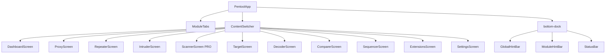
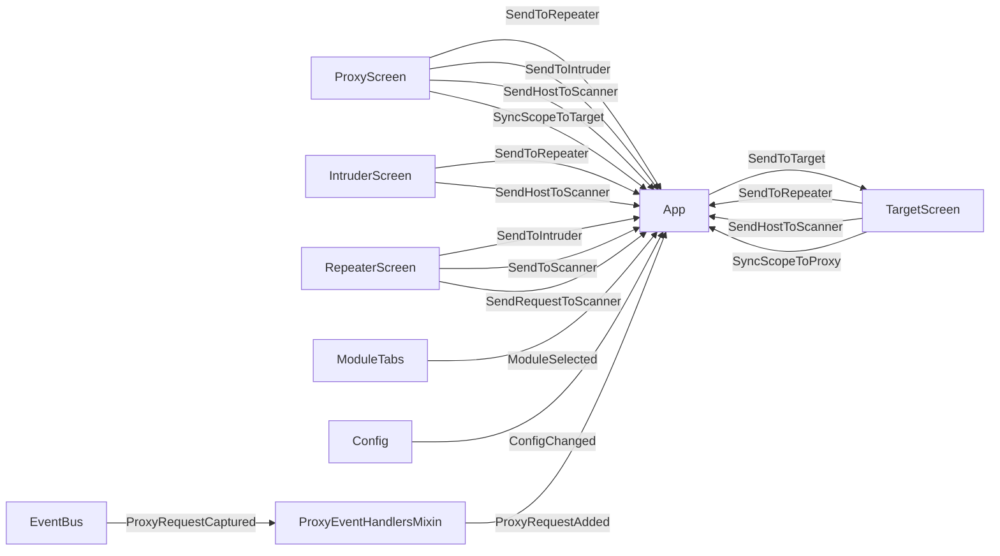

# TUI Audit — REPORT

**Дата:** 2026-11-06
**Ветка:** `audit/tui-refactor-2026-11-06` (от `develop` @ `b3b1749`)
**Textual:** 8.2.8 (`.venv/lib/python3.14/site-packages/textual`), `pyproject.toml` требует `>=0.40.0`
**Объём TUI:** 21 269 строк `.py` в 96 файлах + 2 655 строк `.tcss` в 44 файлах — крупнейший слой проекта (следующий по размеру — `modules/`, 4 670).

Все находки ниже проверены чтением кода и, где отмечено **[проверено]**, исполнением в реальном Textual 8.2.8 (`run_test()`). Непроверенные утверждения помечены «требует уточнения».

---

## 0. Карта проекта

```
pentool/
  utils/ (3025)  core/ (3361)  modules/ (4670)  api/ (1178)  services/ (2761)
  storage/ (1107)  proxy/ (956)  collections/ (311)  export/ (698)  cli/ (859)
  tui/ (21269)   ← предмет аудита
pro/                        ← PRO-подмодуль (scanner, recon); не в git-индексе
tests/  unit/ (в т.ч. 292 TUI-теста)  e2e/  integration/  snapshot/  perf/
```

### 0.1 Что считается «TUI-слоем»

| Компонент | Файлов | Строк |
|---|---|---|
| `pentool/tui/app.py` | 1 | 1691 |
| `pentool/tui/screens/**` | 22 | 9 000 |
| `pentool/tui/widgets/**` | 41 | 3 600 |
| `pentool/tui/dialogs/**` | 31 | 1 400 |
| `pentool/tui/mixins/**` | 12 | 1 400 |
| `pentool/tui/hotkeys/**` | 2 | 467 |
| `pentool/tui/{messages,constants,screen_registry,project_manager}.py` | 4 | 1000 |

### 0.2 Composition root

Единственная точка сборки — `PentoolApp.__init__` и `PentoolApp.on_mount` (`pentool/tui/app.py:140-514`). Приложение само создаёт адаптеры инфраструктуры:

| Что создаётся в App | Строка | Слой, чей это код |
|---|---|---|
| `ProxyClient` / `ProxyServer` | `app.py:364`, `:372` | `pentool.proxy` / `pentool.api` |
| `ProxyAPI` | `app.py:149` | `pentool.api` |
| `ProxyService` | `app.py:390` | `pentool.services` |
| `ProjectManager(self)` | `app.py:195` | `pentool.tui` |
| `init_db(self._cfg.db_path)` | `app.py:355` | `pentool.core` |
| `get_event_bus()` | `app.py:407` | `pentool.core` |

Глобальные синглтоны, на которые опирается TUI: `get_config()` (`pentool.core.config`), `get_event_bus()` (`pentool.core.event_bus`), `HotkeyRegistry.get_instance()` (`hotkeys/__init__.py:96`). Замена на DI-порты не выполнялась и в этом аудите не планируется — это уйдёт в план миграции как отдельная итерация (см. DECISIONS.md, ADR-4).

### 0.3 Дерево виджетов (упрощённо)



Каждый экран — `Widget` (не `Screen`), монтируется один раз в `compose()` приложения и переключается `ContentSwitcher.current`. Это важно: `on_show`/`on_hide` на них **работают** (**[проверено]**, `/tmp/show_test.py` → `Show`/`Hide` доставляются виджетам внутри `ContentSwitcher`).

### 0.4 Граф сообщений

`pentool/tui/messages.py` (116 строк) — 15 классов. Плюс вложенные `Message` в виджетах (13 классов). Плюс доменные события `pentool/core/events.py` (16 классов), которые приходят через EventBus и моста-миксин `ProxyEventHandlersMixin`.



Полная таблица producer/handler — в приложении A этого файла.

---

## 1. Инвентаризация

### 1.1 Экраны

| Экран | Файл | Строк | Базовый класс | Toolbar id | Start/Stop |
|---|---|---|---|---|---|
| Proxy | `screens/proxy/screen.py` | 2146 | `ContentClipboardMixin, SortableTableMixin, RequestContextMenuMixin, AppMixin, InterceptMixin, Widget` | `#toolbar` (по умолчанию) | нет |
| Intruder | `screens/intruder/screen.py` | 2620 | `BaseModuleScreen, AppMixin, ContentClipboardMixin, AutoSaveMixin, …` | `#intruder-global-toolbar` | `StartStopWidget` |
| Target | `screens/target/screen.py` | 1028 | `ContentClipboardMixin, Widget` | `#toolbar` (по умолчанию) | нет |
| Repeater | `screens/repeater/screen.py` | 988 | `AutoSaveMixin, BaseModuleScreen, RequestContextMenuMixin, AppMixin` | `#toolbar` (по умолчанию) | нет |
| Dashboard | `screens/dashboard/screen.py` | 842 | `Widget` | нет | нет |
| Settings | `screens/settings/screen.py` | 798 | `Widget` | нет | нет |
| Sequencer | `screens/sequencer/screen.py` | 512 | `ContentClipboardMixin, Widget` | `#toolbar` (по умолчанию) | свои `btn-seq-*` |
| Decoder | `screens/decoder/screen.py` | 345 | `ContentClipboardMixin, Widget` | `#toolbar` (по умолчанию) | нет |
| Comparer | `screens/comparer/screen.py` | 269 | `ContentClipboardMixin, Widget` | `#toolbar` (по умолчанию) | нет |
| Extensions | `screens/extensions/screen.py` | — | `Widget` | нет | нет |
| ScannerУ недоступен | `screens/scanner_unavailable.py` | 50 | `Widget` | нет | нет |
| Scanner/Recon (PRO) | `pro/pentool/tui/screens/…` | 2526 | `BaseModuleScreen, RequestContextMenuMixin` | `#toolbar` (по умолчанию) | «свои» |

### 1.2 Виджеты (41 файл)

Базовые/переиспользуемые: `Toolbar`, `ToolbarButton`, `StartStopWidget`, `ContentPanel`, `ArrowBackendDataTable`, `ProxyDataTable`, `IntruderResultsTable`, `SortableTableMixin`, `FilterBarWidget`, `ProxyFilterBar`, `WsFilterBar`, `IntruderFilterBar`, `Cycler`, `ToggleButton`, `OptionCycler`, `NiceCheckbox`, `ResizeHandle`, `ContextMenu`, `SearchBar`, `TabbedContentPanel`, `StatusBar`, `ActivityIndicator`, `ModuleTabs`, `GlobalHintBar`, `ModuleHintBar`, `DiffPanel`, `InspectorPanel`, `PayloadDropZone`, `CustomNotify`, `InterceptMixin`.

Мёртвые/неиспользуемые: `menu.tcss`, `menu_bar.tcss`, `filter_bar.tcss` (не загружаются ни одним `.py`). Удалены в D-итерации: `filter_connector.py` (F-039) и `start_stop_mixin.py` (F-019).

### 1.3 Диалоги (17 файлов + 14 `.tcss`)

`BaseDialog` — база для 6 из 17. Остальные 11 наследуются от `ModalScreen` напрямую и копируют ту же CSS-геометрию (`align: center middle` + `#dialog`), см. F-024.

### 1.4 Воркеры

`@work` — 2 шт (`dashboard/screen.py:538` thread=True, `:571` async). `run_worker(...)` — 39 вызовов. `asyncio.create_task` — 2 (`mixins/auto_scope.py:115`, `:160`). Подробности — приложение B.

### 1.5 Совокупное состояние тестов на момент аудита

| Набор | Команда | Результат |
|---|---|---|
| `tests/unit` | `scripts/run-tests.sh` | **2339 passed, 1 skipped**, exit 0 |
| `tests/e2e` + `tests/snapshot` | `uv run pytest tests/e2e tests/snapshot -q` | **4 failed (e2e), 10 failed (snapshot)**, остальные passed |
| `tests/integration` | не запускался | — |

Падения `e2e`/`snapshot` **предсуществующие**, к этому аудиту отношения не имеют (подробнее — F-031…F-033). Это принципиально: гейт `scripts/run-tests.sh` проверяет только `tests/unit`, поэтому регрессии в живом рендере и в снапшотах проходят незамеченными.

---

## 2. Находки

Приоритеты: **P0** — неверное поведение или краш в проде; **P1** — архитектурный риск, утечки, недостижимая функциональность; **P2** — долг, читаемость, дубли.

Всего 46 находок: F-001…F-040 из первичного проходa и F-041…F-046, добавленные и исправленные в D-итерации (проверка исполнением показала, что класс «хендлер написан, но не диспатчится» встречается чаще, чем казалось).

### Топ-10 критичных

| # | Находка | Почему в топе |
|---|---|---|
| 1 | **F-001** Copy/Paste в 6 из 7 экранов не работают | функциональность, заявленная в UI, молча мертва |
| 2 | **F-041** три хендлера `ProxyDataTable` с двойным подчёркиванием | бесконечная история и клик по 💬 не работают вовсе |
| 3 | **F-003** TECH-DETECT падает с `NameError`, проглоченным `except Exception` | мёртвая ветка обогащения Target-дерева |
| 4 | **F-004** `_load_stats_bg` всегда выходит по `if not db_path` | дашбордная статистика не загружается никогда |
| 5 | **F-005** `_get_active_text` → `NameError: TextArea` в Repeater | поиск по ответу всегда пуст (исключение съедено) |
| 6 | **F-045** `workers.cancel(...)` не существует — отмена автосейва не работала | сохранение могло писать в уже закрытую БД |
| 7 | **F-002** подписки EventBus в Dashboard/Intruder/Target не отписываются | утечка + повторный вызов при пересоздании экрана |
| 8 | **F-042/F-043** `on_input_blur`, `on_static_click` — имена без сообщений | переименование вкладки и переключатели поиска не работают |
| 9 | **F-006** дубли `id="toolbar"` на 6+ экранах + `id="dialog"` на 13 диалогах | `query_one` возвращает «чужой» виджет при совпадении |
| 10 | **F-009** 615 `except Exception`, 286 из них → `pass` | именно они скрывали F-001…F-005, F-041…F-045 |

### Статус находок на ветке `audit/tui-refactor-2026-11-06`

| Находка | Статус | Что сделано |
|---|---|---|
| F-001 | ✅ исправлено | `ContentClipboardMixin` переведён на соглашение об именах (ADR-3); 3 копии `_on_cp_paste` удалены; тесты проверяют эффект в буфере, а не «не упало» |
| F-002 | ✅ исправлено | новый `mixins/ai_sync.py::AiModeSyncMixin` — хендлер хранится в `_ai_handler`, снимается в `on_unmount` |
| F-003 | ✅ исправлено | `services/tech_detector.fingerprint_from_html()` + `cache_tech_profile()`; TUI больше не тянет `TechFingerprinter` из `modules` |
| F-004 | ✅ исправлено | `DashboardScreen._get_db_path()` читает публичный `app.db_path` |
| F-005 | ✅ исправлено | `_get_active_text`/`_jump_to_match` работают через `ContentPanel.content_widget`; `TextArea` импортирован |
| F-006 | ✅ исправлено (частично) | `Toolbar(id=None)` по умолчанию — дублей `#toolbar` больше нет; дубли `#dialog` в диалогах остаются (F-024) |
| F-007 | ✅ исправлено | 53 неиспользуемые константы удалены (ADR-9); гвард `test_constants_are_used.py` |
| F-008 | ✅ исправлено | селекторы сверены с DOM, мёртвые удалены; гейт `tools/check_tui_css.py` в CI и pre-commit |
| F-009 | 🟡 частично | **Молчаливые хендлеры закрыты 2026-11-15**: `except Exception: pass` 284 → 0, базовая линия трещотки пуста. Осталось 586 широких `except` (117 без записи); блокирующий `BLE001` — 770 срабатываний по `pentool/`, отдельная итерация |
| F-010 | ✅ исправлено | `F821` в `pentool/tui` — 0 (`TYPE_CHECKING`-импорты) |
| F-011 | ✅ исправлено | удалён мёртвый `query_one(ToolbarButton)` и несуществующий `from textual.widgets import Toolbar` — лог-спам `NoMatches` на каждом `AiModeChanged` прекратился |
| F-036 | ✅ исправлено | то же место: импорт, падавший `ImportError` под `except Exception: pass`, удалён; видимость AI-кнопок теперь обновляется |
| F-013 | ✅ исправлено (частично) | подписки `AiModeChanged` снимаются через `AiModeSyncMixin.on_unmount`; `Config.add_observer` — в `_on_exit_app` (F-046, ADR-12) |
| F-017 | ✅ исправлено | четыре копии посимвольной вставки удалены; остался один `_paste_text_to_panel` |
| F-019 | ✅ исправлено | `start_stop_mixin.py` + `TestStartStopMixin` удалены |
| F-039 | ✅ исправлено | `filter_connector.py` удалён |
| F-034 | ✅ исправлено | `TestComparerCopyPaste` переписан: подмена буфера + проверка `TextArea`/`copy_to_clipboard` |
| F-018 | ✅ исправлено | `Toolbar(id=None)` по умолчанию (`toolbar.py:46`); `StartStopWidget` дубля не создаёт |
| F-041 | ✅ исправлено | три хендлера переименованы; `ContextMenuRequest` теперь действительно постится |
| F-042 | ✅ исправлено | `on_input_blur` → `on_input_blurred` в `base.py` и `tab_panel.py` |
| F-043 | ✅ исправлено | `on_static_click` → `on_click`; переключатели поиска реагируют на мышь |
| F-044 | ✅ исправлено | `RowActivated` заменён на детект `Click.chain == 2` |
| F-045 | ✅ исправлено | `AutoSaveMixin._start_save_worker` + `cancel_group`; отмена автосейва реально работает |
| F-046 | ✅ исправлено | `remove_observer` в `_on_exit_app`; мёртвый `on_screen_unmounted` удалён |
| F-037 | ❌ опровергнуто | `Binding("escape", "dismiss(None)")` работает: проверено на `CommentDialog` и `SaveProjectDialog` — Esc закрывает, `None` возвращается |
| прочие | ⏳ | перечислены в SUMMARY.md с причинами отсрочки |

Новые тесты-гварды против этого класса ошибок: `tests/unit/tui/test_handler_name_dispatch.py` (AST-обход всех `on_*` в `pentool/tui`).

---

### F-001 [P0] Сообщения `ContentPanel.CopyRequested` / `PasteRequested` не обрабатываются на 6 экранах

**Где:**
- `pentool/tui/mixins/content_clipboard_mixin.py:18` и `:30` — `@on(ContentPanel.CopyRequested)` / `@on(...PasteRequested)` объявлены в **обычном классе-миксине**.
- Пользователи миксина: `screens/proxy/screen.py:82`, `screens/target/screen.py:125`, `screens/decoder/screen.py:27`, `screens/comparer/screen.py:29`, `screens/sequencer/screen.py:37`, `screens/intruder/screen.py:134`.
- Кнопки, которые эти сообщения постят: `widgets/content_panel.py:264` (`copy`), `:268` (`paste`).

**Что:** Textual 8 собирает `@on(...)`-хендлеры в **`__init_subclass__` конкретного класса** (`textual/message_pump.py:79-93` — итерация `class_dict`, не MRO). Миксин, у которого нет `MessagePump` в базе, `_decorated_handlers` не получает вовсе.

**[проверено]** `/tmp/clip_test2.py`:
```
mixin dict has handlers key: False
CopyRequested handled? None
```
`/tmp/paste2.py`: `pasted via mixin: 0` при отправленном `PasteRequested`.
`/tmp/copy_broken_test.py` на `SequencerScreen`: `screen handlers: []`, `_decorated_handlers present: False`.

Собственные копии хендлеров есть только у Comparer (`screen.py:79`), Decoder (`screen.py:127`), Intruder (`screen.py:561`) — и только для `PasteRequested`. `CopyRequested` не ловится **никем**.

**Почему:** кнопки «⧉» и «⎘» отрисованы на 11 `ContentPanel` (`comparer:62,66,74`, `decoder:69,81,95`, `intruder:369`, `proxy:213,301`, `repeater:332`, `sequencer:104`, `target:187`). Нажатие копирует… ничего. На Proxy, Target, Sequencer, Repeater кнопки copy/paste полностью no-op. Регрессия не видна в тестах: `tests/unit/test_comparer_screen.py:154-188` прямо оговаривает «просто не упало — уже проверка».

**Как:**
1. Перевести `ContentClipboardMixin` в иерархию Textual — он должен наследовать `Widget` (или быть превращён в `ContentPanelHost(Widget)`), чтобы `__init_subclass__` MessagePump выполнился при объявлении. Либо
2. использовать соглашение об именах — `def on_content_panel_copy_requested(self, event)` (хендлеры без `@on` берутся из MRO обходом `_get_dispatch_methods`, `message_pump.py:797-801`) — это **[проверено]** работает для миксинов (`/tmp/handler_name_test.py` → `mixin conventional handler hits: 1`).
3. Убрать три копии `_on_cp_paste` из Comparer/Decoder/Intruder — их перекрывает базовый миксин, но они содержат захардкоженную логику выделения.

**Связи:** F-009 (почему не поймали), F-017 (дубли paste-логики), F-034 (degraded тест).

---

### F-002 [P1] Подписка на `AiModeChanged` в трёх экранах не отписывается

**Где:**
- `screens/dashboard/screen.py:429-437` (`_init_ai_sync`, подписка на замыкание `_on_ai_mode`)
- `screens/intruder/screen.py:829-834`
- `screens/target/screen.py:203-215`

**Что:** замыкание-хендлер уходит в `EventBus.subscribe(...)` и нигде не хранится — `on_unmount` у этих экранов отсутствует. `get_event_bus()` — процесс-глобальный синглтон (`core/event_bus.py:57`).

**Почему:** `DashboardScreen`/`IntruderScreen`/`TargetScreen` монтируются один раз в `PentoolApp.compose()`, поэтому *в текущем* жизненном цикле подписка одна. Но (а) хендлер держит ссылку на экран вечно — GC не соберёт; (б) любой path, пересоздающий экран (тесты, `run_test()`, будущий `recompose`), удваивает хендлеры: `subscribe` дедуплицирует только при **идентичной** функции (`event_bus.py:71`), а каждый вызов `_init_ai_sync` создаёт новое замыкание; (в) `_on_ai_mode` в Intruder вызывает `_sync_ai_ui`, который делает `self.query_one(ToolbarButton)` и глотает `NoMatches` — то есть после размонтирования на каждый `AiModeChanged` летит исключение через `except Exception`.

Контраст: `ProxyScreen` делает это правильно — `screen.py:335` / `:388` пара subscribe/unsubscribe. `SequencerScreen` — тоже (`:266` / `:274`).

**Как:**
```python
# pentool/tui/mixins/ai_sync.py
from __future__ import annotations
from pentool.core.event_bus import get_event_bus
from pentool.core.events import AiModeChanged

class AiModeSyncMixin:
    def _init_ai_sync(self) -> None:
        self._ai_handler = self._on_ai_mode_changed
        get_event_bus().subscribe(AiModeChanged, self._ai_handler)
        self._sync_ai_ui()

    def _on_ai_mode_changed(self, event: AiModeChanged) -> None:
        self.call_after_refresh(self._sync_ai_ui)

    def on_unmount(self) -> None:
        handler = getattr(self, "_ai_handler", None)
        if handler is not None:
            get_event_bus().unsubscribe(AiModeChanged, handler)
            self._ai_handler = None
```
и заменить три локальных `_init_ai_sync` на миксин. `_sync_ai_ui` остаётся разным у каждой панели (это UI-деталь), хендлер — общий.

**Связи:** F-013 (утечка подписок как класс), F-035.

---

### F-003 [P0] `NameError: TechFingerprinter` в `_tech_detect_and_cache` — ветка fallback мертва

**Где:** `pentool/tui/mixins/auto_scope.py:207`.
```python
fp = TechFingerprinter()          # ← не импортирован
profile = await fp.fingerprint(url, http_client, body=html)
```
`ruff --select F821` подтверждает: `auto_scope.py:207:22: Undefined name 'TechFingerprinter'`.

**Что:** ветка «Lightpanda fallback» исполняется всегда, когда `run_fingerprint` вернул `None` и Lightpanda доступен. Всё, что она делает, — `NameError`, который ловится `except Exception as exc: log.debug(...)` на `:211`. Профиль остаётся `None`, дальше `if profile is None: return` (`:214`).

**Почему:** детект технологий — одна из ключевых фич Target-экрана (в PRO — Recon). Основной путь `run_fingerprint` (`services/tech_detector.py:73`) возвращает `None` в двух случаях: PRO-пакет не установлен (`ImportError` → `:78`) и `fingerprint()` бросил исключение (`:79`). То есть на **FREE-сборке без PRO** fallback-путь — единственный, который мог бы отработать, и он гарантированно падает. Технологии не определяются никогда.

**Как:**
```python
# services/tech_detector.py — новый публичный фасад
async def fingerprint_from_html(url: str, http_client, body: str) -> dict | None:
    """Detect tech from an already-fetched HTML body (PRO-first, local fallback)."""
    try:
        from pentool.modules.scanner.fingerprint import TechFingerprinter
        profile = await TechFingerprinter().fingerprint(url, http_client, body=body)
        return profile.to_context_dict() if hasattr(profile, "to_context_dict") else None
    except ImportError:
        return None
    except Exception:
        logger.warning("fingerprint_from_html(%s) failed", url, exc_info=True)
        return None
```
и в `auto_scope.py` убрать прямой импорт из TUI целиком (правило `tui ↛ modules` соблюдено через `services`).

Второй баг той же функции — `cache.set(host, profile_dict)` на `:219`: имя `cache` тоже не определено (`F821`). Правильный вызов — `_cache_set` из `services/tech_detector.py:83` (модуль-приватный) или новый публичный `cache_tech_profile(host, profile)`.

**Связи:** F-009, F-004.

---

### F-004 [P0] Дашборд никогда не загружает статистику: `self.app._db_path` не существует

**Где:** `pentool/tui/screens/dashboard/screen.py:574`
```python
db_path = getattr(self.app, "_db_path", "") or ""
if not db_path:
    return
```
**Что:** у `PentoolApp` атрибут называется `db_path` (`app.py:1070-1072`, property) — `_db_path` не задаётся нигде в `pentool/` (grep: `_db_path =` встречается только в `api/*`, `modules/*`, `services/*`, `proxy/*`, `cli/proxy.py` — все прочие объекты). `getattr(..., "")` возвращает `""`, `_load_stats_bg` выходит на первой ветке.

Ср. `target/screen.py:230` делает правильно: `getattr(self.app, "db_path", "") or getattr(self.app, "_db_path", "")`.

**Почему:** `_fetch_stats` (`:582`) — единственный источник `#threat-meter` (severity counts) и `#vuln-matrix`; оба статически нарисованы нулями. Дашборд — стартовый экран (`ContentSwitcher(initial="screen-dashboard")`), то есть первый, что видит пользователь, всегда показывает пустую статистику. В тестах не ловится: `test_dashboard_ai_row.py` проверяет только строку AI.

**Как:** везде в TUI использовать один путь доступа. `AppMixin._get_db_path()` (`mixins/app_mixin.py:26`) уже есть и уже используется шестью экранами; `DashboardScreen` не наследует `AppMixin`, поэтому вместо `getattr`:
```python
def _get_db_path(self) -> str:
    try:
        return self.app.db_path
    except Exception:
        return ""
```
— либо, лучше, наследовать `AppMixin` и удалить локальную копию.

**Связи:** F-005, F-006.

---

### F-005 [P1] Repeater: поиск по response всегда пуст — `NameError: TextArea`

**Где:** `pentool/tui/screens/repeater/screen.py:629`
```python
area = viewer.query_one("#viewer-area", TextArea)   # TextArea не импортирован
```
`import TextArea` в модуле нет (`screen.py:9-33` импортирует `Input, Static, TabbedContent, TabPane` и `Selection`), `ruff --select F821` подтверждает. Исключение съедено на `:631-632` (`except Exception: return ""`).

**Что:** `_get_active_text()` при `_search_target == "response"` всегда возвращает `""`. Вызывается из `_search` (`:549`), `_search_next`/`_search_prev` (`:582`), `action_send_to_decoder` (`:862`), `action_send_to_comparer` (`:866`), `action_send_to_intruder` (`:875`), copy-as (`:971`, `:980`).

**Почему:** заявленная функция «искать в ответе» и «отправить ответ в Decoder/Comparer/Intruder» на Repeater молча не работает. Пользователь видит «0 matches» и нотификацию без объяснения.

**Как:**
```python
from textual.widgets import Input, Static, TabbedContent, TabPane, TextArea
```
Одна строка. Дополнительно — обернуть `_get_active_text` в логирование с уровнем `warning` вместо `return ""` с голым `except`, чтобы такой класс ошибок не повторялся (см. F-009).

**Связи:** F-009.

---

### F-006 [P1] Дубли `id` внутри дерева одного приложения

**Где (полная карта — приложение C):**

| id | Где | Кол-во |
|---|---|---|
| `toolbar` | `Toolbar.__init__(id="toolbar")` по умолчанию; 6 экранов не задают свой | 6 одновременно смонтированы |
| `dialog` | все `ModalScreen`-диалоги | 13 файлов (не одновременно) |
| `buttons` | то же | 10 файлов |
| `title`, `hint` | то же | 6 / 5 |
| `screen-scanner` | `app.py:317` + `scanner_unavailable.py:35` | 2 (не одновременно) |
| `fb-apply`, `fb-reset` | `filter_bar_widget.py:148-149`, `proxy_filter_bar.py:83-84`, `:204-205` | 3 (по 2 одновременно в Proxy) |
| `btn-cancel`, `btn-load` | `confirm.py:53` / `load_from_proxy.py:54` / `project_dialog.py:33,68` | между диалогами |

**[проверено]** `/tmp/dup_id_test.py` и `/tmp/dupid2.py`: Textual 8.2.8 **не падает** на дублях id, `query("#toolbar")` возвращает 2+ узла, `query_one("#toolbar")` возвращает **первый в порядке обхода**, а не бросает.

**Почему:** все экраны смонтированы одновременно, значит `app.query_one("#toolbar")` вернёт toolbar Comparer'а (первым в `compose`). Пока никто не делает такой запрос — дефект латентный. Но в коде уже есть места, которые полагаются на «свой» toolbar: `StartStopWidget` строит `Toolbar(...)` без id (`widgets/start_stop_widget.py:91`), то есть третьего кандидата на `#toolbar`; а `IntruderScreen._sync_ai_ui` (`screen.py:844`) делает `self.query_one(ToolbarButton)` — это уже `NoMatches` (пишет в лог, как видно в e2e-логе: `No nodes match 'ToolbarButton' on IntruderScreen`).

**Как:** всем `Toolbar`-ам задать уникальный id либо не задавать вовсе (Textual генерирует уникальный автоматический id, если `id=None`). Минимальное исправление — в `Toolbar.__init__` сделать `id: str | None = None`, а id задавать на местах, где на него действительно опираются через `query_one`. Проверить, что ничего не ищет `#toolbar` (grep — 0 совпадений), затем руками проставить `id` в шести экранах (`comparer:42`, `decoder:43`, `proxy:178`, `repeater:142`, `sequencer:57`, `start_stop_widget:91`).

**Связи:** F-007, F-030.

---

### F-007 [P2] `pentool/tui/constants.py` — 53 из 61 константы не используются

**Где:** `pentool/tui/constants.py` (61 константа, 1 строка каждая). Проверка: имя константы не встречается ни в одном `.py` под `pentool/`, `pro/` (кроме самого файла).

Неиспользуемые: `SCREEN_SEQUENCER`, `SCREEN_EXTENSIONS`, `SCREEN_SETTINGS`, `BTN_PROXY`, `BTN_INTERCEPT`, `BTN_FORWARD`, `BTN_DROP`, `BTN_SCOPE`, `BTN_MR`, `BTN_CLEAR`, `BTN_LOAD_HISTORY`, `PROXY_SUBTABS`, `TAB_INTERCEPT`, `TAB_HTTP_HISTORY`, `TAB_WS_HISTORY`, `INTERCEPT_PANEL`, `INTERCEPT_HINT`, `INTERCEPT_RESP_VIEWER`, `REQUEST_LIST`, `WS_REQUEST_LIST`, `REQ_EDITOR`, `RESP_VIEWER`, `WS_REQ_EDITOR`, `WS_RESP_VIEWER`, `FILTER_BAR`, `INSPECTOR_PANEL`, `RESIZE_TABLE_DETAIL`, `RESIZE_REQ_RESP`, `RESIZE_INTERCEPT`, `BTN_START`, `BTN_STOP`, `BTN_PAUSE`, `BTN_CANCEL`, `RESULTS_TABLE`, `ATTACK_PROGRESS`, `TEMPLATE_EDITOR`, `TARGET_INPUT`, `SCAN_PROGRESS`, `FINDINGS_TREE`, `SITE_TREE`, `DETAIL_LOG`, `SETTINGS_TABS`, `SET_PROXY_HOST`, `SET_PROXY_PORT`, `SET_UPSTREAM`, `SET_THEME`, `SET_UI_MODE`, `SETTINGS_SAVE`, `SETTINGS_SAVE_PROXY`, `SETTINGS_SAVE_PROJECT`, `SETTINGS_OPEN_CA`, `STATUSBAR`, `MODULE_TABS`.

Используются 8: `SCREEN_PROXY`, `SCREEN_REPEATER`, `SCREEN_INTRUDER`, `SCREEN_SCANNER`, `SCREEN_TARGET`, `SCREEN_DECODER`, `SCREEN_COMPARER`, `SCREEN_DASHBOARD`.

**Почему:** файл заявлен как «single source of truth for string identifiers», но 87 % строк в нём — декорация. Хуже: именно потому что id существуют в литералах по месту, дубли (F-006) и мёртвые CSS-селекторы (F-008) не отслеживаются.

**Как:** два осмысленных варианта, выбрать в DECISIONS. Рекомендация — **удалить неиспользуемые константы** (не «подключить всё», это был бы большой механический рефактор без выигрыша) и оставить в файле только то, что реально импортируется, с docstring «only identifiers that are queried from outside the owning module».

**Связи:** F-006, F-008, F-030.

**Статус (2026-11-11): закрыто.** Оставлены только 8 импортируемых `SCREEN_*`;
остальные 53 удалены. В docstring зафиксировано правило: константа попадает
сюда, когда её читает **второй** модуль; id, живущий в одном экране, остаётся
литералом рядом со своим виджетом — константа, которую импортирует только её
же модуль, добавляет косвенность, а не безопасность.

Гвард — `tests/unit/tui/test_constants_are_used.py`: каждая константа обязана
где-то импортироваться (повторное гниение ловится), множество обязано состоять
только из `SCREEN_*` и без дублирующихся значений.

---

### F-008 [P1] 11 CSS-селекторов никогда не совпадают с DOM

**Где (проверено сопоставлением `.tcss` ↔ `classes=`/`add_class`/id в `.py`):**

| Селектор | Файл:строка | Причина несовпадения |
|---|---|---|
| `.attack-type-desc` | `intruder/screen.tcss:84` | в коде это **id**: `id=t("attack-type-desc")` (`screen.py:357`) |
| `.progress-label` | `intruder/screen.tcss:178` | id: `screen.py:428` |
| `.intruder-filter-bar` | `intruder/screen.tcss:189-209` | id: `screen.py:423` |
| `.intruder-tab-toolbar` | `intruder/screen.tcss:65,69,75,84,92` | строки нет в `.py` вообще |
| `.grep-bar` | `intruder/screen.tcss:214-231` | строки нет в `.py` |
| `.panel-title` | `proxy/screen.tcss:49` | нет в `.py` |
| `.stub-label` | `proxy/screen.tcss:111` | нет в `.py` |
| `.dec-col-label` | `decoder/screen.tcss:52` | нет в `.py` |
| `.cmp-col-label` | `comparer/screen.tcss:33` | нет в `.py` |
| `.detail-label`, `.in-scope` | `target/screen.tcss:22,29` | нет в `.py` |
| `.variant-success`, `.variant-warning` | (задаются из `content_panel.py:177,280`) | **правила нет ни в одном CSS** |

**Что:** три первых — прямое несовпадение типа селектора (`#x` в DOM против `.x` в CSS); они должны были быть id-селекторами. Остальные — мёртвые правила.

**Почему:** у `IntruderScreen` панель фильтра и прогресс-строка рисуются без заявленных в CSS стилей (нет `height: 2`, нет `layout: horizontal`, `Input` не получает `width: 8`). Since CSS и Python пишутся раздельно, ни линтер, ни тесты этого не видят. `variant-success/warning` — отдельный случай: `ContentPanel` ставит класс, CSS нет → кнопка «wrap» не меняет цвет при переключении.

**Как:** (1) переписать три селектора на id-форму:
```tcss
IntruderScreen .attack-type-desc                 { width: 1fr; height: 1; padding: 0 1; color: $text-muted; }
IntruderScreen .progress-row .progress-label     { width: auto; color: $text-muted; padding: 0 1; }
IntruderScreen IntruderFilterBar                 { height: 2; background: $panel; padding: 0 1; }
```

> Атрибутные селекторы (`[id^="…"]`) здесь неприменимы: Textual 8 их не
> парсит (см. статус ниже). Виджет получает класс с той же базой, что и id.
(2) удалить мёртвые блоки; (3) добавить в `toolbar_button.tcss`:
```tcss
ToolbarButton.variant-success { color: $success; }
ToolbarButton.variant-warning { color: $warning; }
```
(4) добавить проверку в CI — скрипт `tools/check_tui_css.py`, сопоставляющий классы/ids из `.tcss` с литералами в `.py` (см. D-итерацию 6).

**Связи:** F-007, F-038 (CSS-дубли).

**Статус (2026-11-10): закрыто.** Три типа-ошибки переписаны на
классовые селекторы (`.attack-type-desc`, `.progress-label` — класс ставится
рядом с id; `IntruderFilterBar` по типу), 6 мёртвых блоков удалены, `.variant-success`/
`.variant-warning`/`.pro-locked` добавлены в `toolbar_button.tcss`, `.sending`
удалён как неиспользуемый. Гейт — `tools/check_tui_css.py` (0 проблем на
корпусе 44 `.tcss`), шаг CI + pre-commit, тест
`tests/unit/tui/test_check_tui_css.py`. Попутно найдено и удалено ещё 4 мёртвых
правила (`#dec-steps-label`, `TargetScreen #detail-log`,
`CertInstallDialog .note`, `PayloadDropZone.-drag-over`) и исправлен
`TabLabel` → `Tab` (такого класса в Textual нет).

---

### F-009 [P1] 615 `except Exception`, 286 из них — `pass`; именно они скрывают P0

**Где:** подсчёт `grep -rc "except Exception" pentool/tui`. Примеры-носители багов: `auto_scope.py:211` (F-003), `repeater/screen.py:631` (F-005), `dashboard/screen.py:579` (F-004 маскируется `getattr`), `intruder/screen.py:849` (F-006), `services/tech_detector.py:79` (F-003).

**Почему:** ловля `Exception` без логирования или с `log.debug` в файл, который пользователь не читает, превращает `NameError`/`NoMatches`/`AttributeError` в «фича просто не работает». В TUI это особенно опасно: любая ошибка в хендлере попадает в цепочку `MessagePump` и без явного лога исчезает.

**Как:** не «убрать все», а ввести правило и применить его точечно в местах, где сейчас ловятся программные ошибки:
1. В хендлерах/воркерах ловить `NoMatches`, `AttributeError`, известные сетевые исключения — явно, списком.
2. Всё остальное — `logger.exception(...)` (не `debug`), чтобы фатальный класс ошибок попадал в `pentool.log`.
3. Ввести `ruff`-правило `BLE001` (`blind-except`) в режиме warning для `pentool/tui` в отдельном PR — включение blocking потребует 615 правок, поэтому в этом аудите только каталогизация.

**Связи:** F-003, F-004, F-005.

---

**Статус (2026-11-15): молчаливые хендлеры закрыты.** `except Exception: pass`
в `pentool/tui/` — 0 (было 284 в 39 файлах). Трещотка
`tools/check_silent_except.py` сверяется с `tools/silent_except_baseline.json`;
базовая линия теперь пуста, поэтому любой новый `except Exception: pass` —
хоть первый в файле — роняет CI и pre-commit, а не только «лишний сверх
нормы». Остаток вне трещотки — 117 широких `except` без записи в журнал
(тело не `pass`, а запасной путь) и 586 широких `except` всего; их закрывает
пункт 1 ADR-6 (`logger.exception`) и блокирующий `BLE001` (770 срабатываний
по `pentool/`) — отдельная итерация.

### F-010 [P1] `from __future__ import annotations` маскирует 8 неопределённых имён (`F821`)

**Где:** `ruff --select F821 pentool/tui`:

| Файл:строка | Имя |
|---|---|
| `mixins/auto_scope.py:207` | `TechFingerprinter` (F-003) |
| `mixins/auto_scope.py:219` | `cache` (F-003) |
| `screens/intruder/screen.py:729, 885, 925, 985` | `IntruderAPI` — только в аннотациях строками |
| `screens/repeater/screen.py:629` | `TextArea` (F-005) |
| `widgets/content_panel.py:168` | `ComposeResult` — аннотация возврата `compose` |

**Что:** четыре из восьми — аннотации, которые никогда не вычисляются в рантайме благодаря `from __future__ import annotations` (`screen.py:7`). Это безопасно *пока* никто не вызовет `typing.get_type_hints()` или `inspect.signature(..., eval_str=True)`. TUI-фреймворки и тестовые утилиты это делают регулярно.

**Как:** для `IntruderAPI` — `if TYPE_CHECKING: from pentool.api.intruder_api import IntruderAPI` (паттерн уже применяется в `project_manager.py:27`). Для `ComposeResult` — `from textual.app import ComposeResult`. Для остальных двух — это F-003/F-005, исправляются там.

**Связи:** F-003, F-005.

---

### F-011 [P1] `query_one` в горячем пути AI-синхронизации падает на каждом событии

**Где:** `pentool/tui/screens/intruder/screen.py:844`
```python
btn = self.query_one(ToolbarButton)  # fallback — per-tab кнопки будут позже
```
Переменная `btn` не используется (`ruff F841`), а `query_one` бросает `NoMatches`, когда в текущем табе нет `ToolbarButton` — что верно для экрана после закрытия всех табов. Исключение ловится на `:850` и пишется в `logger.debug`.

**[проверено]** в e2e-прогоне: сотни строк `DEBUG … op: No nodes match 'ToolbarButton' on IntruderScreen(id='screen-intruder')`.

**Почему:** это лог-спам на каждое `AiModeChanged`; при включённом `DEBUG`-уровне (а в `pentool.log` часто включён при разборе багов) он раздувает файл и мешает грепать настоящие ошибки. Сам код мёртв — `btn` никуда не идёт, реальная работа делает `self.query(".pro-locked")`.

**Как:** удалить обе строки `btn = …` и вложенный `try/except` вокруг `from textual.widgets import Toolbar as _Toolbar` (этот импорт тоже неверен — `textual.widgets.Toolbar` не существует, **[проверено]** `hasattr(textual.widgets,'Toolbar') → False`).

**Связи:** F-006, F-009.

---

### F-012 [P1] `_proxy_api` дублирует `ProxyService` — два пути к одному хранилищу

**Где:**
- `app.py:149` — `self._proxy_api: ProxyAPI = ProxyAPI()`;
- `app.py:387` — `self._proxy_api.set_proxy(self._proxy)`;
- `app.py:390` — `ProxyService(proxy_api=self._proxy_api, db_path=…)`;
- `app.py:398` — `proxy_screen._proxy_service = self._proxy_service`.

**Что:** `ProxyScreen` получает `ProxyService` **присваиванием приватного поля извне** (не через конструктор, не через reactive, не через DI), причём `ProxyScreen.__init__` уже принимает `proxy_service: ProxyService | None = None` (`screens/proxy/screen.py:100`) — этот параметр не используется при монтировании.

**Почему:** (а) `_proxy_service` на экране может быть `None` до `on_mount` App — все обращения нужно гвардить `if self._proxy_service is None` (в коде 98 вхождений `_proxy_service`/`_get_api()`/`_get_db_path()`, часть — без гварда); (б) в тестах нельзя передать фейк в конструктор экрана, приходится повторять присваивание; (в) `_get_api()` на других экранах (`repeater:180`, `intruder:885`, `target:227`) создаёт **свой** API на `db_path` из конфига — при переключении проекта (`_project_loaded`) эти объекты нужно вручную пересоздавать (`intruder/screen.py:895 _repoint_db`, `repeater` — generation-счётчик `:203`).

**Как:** внедрять через конструктор с самого начала — `ProxyScreen(proxy_service=None)` уже есть, надо передать его в `compose`:
```python
yield ProxyScreen(id="screen-proxy", proxy_service=self._proxy_service)
```
но `_proxy_service` создаётся в `on_mount`, позже `compose`. Значит корректный путь — создать `ProxyService` в `__init__` (он не зависит от event loop) и передать его в `compose`, а `init_storage()` оставить в `on_mount`. Это отдельная итерация D0; в этом аудите — только фиксируем.

**Связи:** F-013, F-016.

---

**Статус (2026-11-11): закрыто.** `ProxyService` создаётся в
`PentoolApp.__init__` (конструктор не трогает event loop — соединение с БД
открывает только `init_storage`) и передаётся в `ProxyScreen(proxy_service=…)`
из `compose`. Присваивание приватного поля из `on_mount` удалено; осталось
только `await self._proxy_service.init_storage()`. Тип поля в App стал
не-Optional. Инвариант проверяется `tests/unit/tui/test_proxy_service_injection.py`:
конструктор, значение по умолчанию `None` и AST-скан, запрещающий запись
`<obj>._proxy_service` извне класса экрана.


### F-013 [P1] Непарные подписки/таймеры как класс проблемы

**Где:**

| Подписка/таймер | Файл:строка | Снимается? |
|---|---|---|
| `AiModeChanged` × 3 | `dashboard:437`, `intruder:834`, `target:215` | **нет** |
| `WebSocketFrameEvent` | `proxy:335` | да (`on_unmount:388`) |
| `ProxyRequestDoneEvent` | `sequencer:266` | да (`_stop_capture:274`, вызов из `on_unmount:505`) |
| `ProxyRequestCaptured`/`Completed`, `FindingDiscovered`, `ScanStarted/Finished/Progress`, `PassiveScanToggled` | `app.py:408-416` | нет (App живёт весь процесс — допустимо) |
| `set_interval(1.0, self._tick)` | `dashboard:413` | нет `on_unmount`; Timer живёт на узле и умрёт вместе с ним — **допустимо** |
| `set_interval(300, _cleanup_pending_req_ids)` | `proxy:319` | то же |
| `set_interval` × 2 | `activity_indicator:196-197` | то же |

**Почему:** Textual сам снимает `Timer`, привязанные к узлу. А `EventBus` — процесс-глобальный объект вне дерева Textual: его подписки **не** снимаются автоматически. Три непарных подписки — единственный реальный дефект этой категории.

**Как:** см. F-002.

**Связи:** F-002.

---

### F-014 [P1] `asyncio.create_task` вне жизненного цикла Textual (2 места)

**Где:** `mixins/auto_scope.py:115`, `:160`.
```python
asyncio.create_task(_tech_detect_and_cache(norm_host, app))
```

**Что:** задача создаётся «снаружи» текст-уала: у неё нет ни ссылки, ни группы, ни отмены. Если она бросит исключение, оно не попадёт ни в один `Worker`, а останется в `Task.exception()` (и в `asyncio` — `Task exception was never retrieved`).

**Почему:** на фоне того, что `_tech_detect_and_cache` содержит гарантированный `NameError` (F-003), это ещё и путь, по которому ошибка не видна вообще. `auto_scope._maybe_auto_scope_host` вызывается из контекстных меню Proxy/Target — то есть на каждый хост.

**Как:** заменить на `app.run_worker(...)` (App — `MessagePump`, у него есть `run_worker`):
```python
try:
    app.run_worker(_tech_detect_and_cache(norm_host, app), group="tech-detect", exclusive=False, exit_on_error=False)
except Exception as exc:
    log.debug("AUTO_SCOPE: tech_detect worker spawn failed: %s", exc)
```
`auto_scope` получает `app` параметром — сигнатура не меняется.

**Связи:** F-003, F-013.

---

### F-015 [P2] `_run_attack` держит ссылку на атаку без отмены по `on_unmount`

**Где:** `screens/intruder/screen.py:2036-2060` (`_run_attack`), `:2142` (`action_stop`).
**Что:** `self.run_worker(self._run_attack(tab, attack), exclusive=False, name=f"intruder-attack-{tab.tab_id}")` — воркер по имени, но `stop` вызывает `tab.attack.stop()` (`:2142`) и `pause/resume` — через `attack.*` (`:2127`, `:2129`). Текст-уальный `Worker` при остановке не отменяется, он дождётся `attack.run()` до конца.
**Почему:** если `attack.stop()` внутри `api.make_attack(...)` окажется небыстрым (а это сетевой цикл), экран держит корутину живой; при закрытии таба воркер остаётся. В e2e это не проявилось, но это то, что мешает `exit_on_error`/`cancel` работать.
**Как:** при закрытии таба (`action_close_tab`) и в `on_unmount` — `self.workers.cancel_node(f"intruder-attack-{tab_id}")` (Textual 8: `workers.cancel_node(name)`), затем `attack.stop()`.
**Связи:** F-013.

---

### F-016 [P2] Три способа получить путь к БД

**Где:**
- `app.db_path` property (`app.py:1070`) — «публичный»;
- `AppMixin._get_db_path()` (`mixins/app_mixin.py:26`) — через property;
- `getattr(self.app, "db_path", None) or getattr(self.app, "_db_path", "")` — `intruder:700`, `target:230`, `target:771`;
- `getattr(self.app, "_db_path", "")` — `dashboard:574` (F-004, всегда пусто).

**Почему:** `_db_path` — атрибут `ProxyService`/`IntruderAPI`/`ProxyClient`, а не `App`; в TUI он не определён. Четыре формы записи дают три разных результата, один из которых — пустая строка.
**Как:** оставить `app.db_path`; `AppMixin._get_db_path()` — единственная точка доступа для экранов; удалить `getattr(..., "_db_path", ...)` во всех четырёх местах.

**Связи:** F-004.

---

### F-017 [P2] Логика вставки скопирована байт-в-байт в 4 места

**Где:** `mixins/content_clipboard_mixin.py:30-51`, `screens/comparer/screen.py:79-108`, `screens/decoder/screen.py:127-159`, `screens/intruder/screen.py:561-590`.

**Что:** 30 строк (разбор `Selection`, склейка строк с `splitlines(keepends=True)`, ветка «выделение из нескольких строк») продублированы четыре раза без единого отличия.

**Почему:** четыре копии ожидаемо разъедутся. Уже разъехались: в миксине вставка идёт через `_paste_text_to_panel`, а экранные копии всегда делают `w.load_text(...)` — то есть **сбрасывают `selection`/`cursor`**, тогда как базовый вариант сохраняет. И ни одна копия не обрабатывает `RichLog` (только `TextArea`), хотя `Paste` доступен и в RichLog-панелях.

**Как:** одна функция в миксине:
```python
def _paste_text_to_panel(self, panel: ContentPanel, text: str) -> None:
    w = panel.content_widget
    if isinstance(w, TextArea):
        sel = w.selection
        if sel is not None and sel.start != sel.end:
            w.replace(text, sel.start, sel.end)      # TextArea.replace — есть в Textual ≥0.50
        else:
            w.insert(text)
    elif hasattr(w, "write"):
        w.write(markup_escape(text))
```
и удалить три экранные копии (с учётом F-001 — они всё равно недостижимы).

**Связи:** F-001, F-034.

---

### F-018 [P2] `Toolbar` дублирует `id="toolbar"` по умолчанию; `StartStopWidget` добавляет третьего кандидата

**Где:** `widgets/toolbar.py:46` — `def __init__(self, *children, id: str = "toolbar")`.
**Что:** все экраны, которые не передают `id`, получают одинаковый.
**[проверено]** `/tmp/dupid2.py` — без падения, `query("#toolbar")` → 2.
**Почему:** см. F-006.
**Как:** `id: str | None = None` + явные id там, где нужны.

**Связи:** F-006.

---

### F-019 [P2] Два независимых механизма Start/Stop, один из них мёртв в проде

**Где:** `widgets/start_stop_mixin.py` (89 строк, `@on`-декораторы) и `widgets/start_stop_widget.py` (161 строка, `Widget` с `StartRequested/PauseRequested/ResumeRequested/StopRequested`).
**Что:** `StartStopWidget` используется **только** `IntruderScreen` (`screen.py:638`). `StartStopMixin` не используется **нигде** в `pentool/` и `pro/` — только в `tests/unit/tui/test_intruder_buttons.py:73-111` (`TestStartStopMixin`, 16 проверок).

**[проверено]** миксин с `@on` в обычном классе не получает хендлеров (тот же механизм, что F-001) — то есть даже те 16 тестов проверяют «есть атрибуты `_running`/`_paused` и вызывает методы», а не доставку сообщений.

**Почему:** мёртвый код + ложное покрытие. Плюс двойная терминология вводит в заблуждение: `_compare_wiki/tui.md:41` утверждает, что «StartStopMixin/StartStopWidget — единственный источник логики», хотя ни Scanner (PRO), ни Recon не используют ни один из двух (Recon/MYPLANS-план).
**Как:** удалить `StartStopMixin` и соответствующий `TestStartStopMixin` (в том же коммите — это не публичный API пакета, а внутренний виджет); оставить `StartStopWidget` как единственный. `MYPLANS/tui-audit-structure.md` §2 и `MYPLANS/tui-unification-plan.md` §2 — обновить (пункт «Сделано» про `StartStopMixin` неверен).

**Связи:** F-020, S-01 (wiki).

**[сделано]** `start_stop_mixin.py` и `TestStartStopMixin` удалены; `StartStopWidget` — единственный механизм Start/Pause/Resume/Stop.

---

### F-020 [P2] Два класса «клик-переключатель» — `Cycler` и `OptionCycler`

**Где:** `widgets/filter_bar_widget.py:34` (`Cycler`, без CSS, `Changed(value)`) и `widgets/option_cycler.py:21` (`OptionCycler`, свой `.tcss`, `Changed(cycler, value)`, `control`-property для `@on`-селекторов).
**Что:** почти идентичный код: список `(label, value)`, `_idx`, `on_click` → `post_message`. Различия: `OptionCycler` поддержит `@on(...)`-селектор (`control`), `Cycler` — нет; `Cycler` умеет `reset()` и пустое значение `""` для опции 0.
**Почему:** один и тот же UX (`ProxyFilterBar` статус-фильтр vs `SettingsScreen` тема vs `Intruder` режим генерации) реализован тремя классами (`Cycler`, `OptionCycler`, до этого `_InputDialog` в intruder).
**Как:** оставить `OptionCycler` (он полнее), добавить в него `reset()` и `allow_empty: bool = False`, удалить `Cycler`, переписать `ProxyFilterBar`/`WsFilterBar` на `OptionCycler`. ~120 строк минус.

**Связи:** F-038 (CSS-дубли фильтр-баров).

**Статус (2026-11-11): закрыто.** `Cycler` удалён; `OptionCycler` получил
`allow_empty: bool = False` (индекс 0 = слот «Any», `value` возвращает `""`)
и `suffix: str = ""` (у фильтр-баров `" ▼"` — та самая подсказка, ради которой
`Cycler` форматировал подпись сам). `reset()` в `OptionCycler` добавлен, плюс
`set_value()` — раньше был только у него. `FilterBarWidget._render_field`,
`_read_field` и `_clear_field` работают с `OptionCycler`; прослушка
`Cycler.Changed` переехала в базу как `on_option_cycler_changed` (имя хендлера
выводится Textual из имени класса сообщения, поэтому обработчик
`on_cycler_changed` в `ProxyFilterBar` без правки просто перестал бы
вызываться — молча, как в F-041).

Гвард — `tests/unit/tui/test_filter_bar_unified.py`: класс `Cycler` не должен
существовать, `allow_empty`/`suffix`/`reset` проверены по поведению.

---

### F-021 [P2] Три фильтр-бара с дублирующей CSS и логикой

**Где:** `widgets/filter_bar_widget.py` (261), `widgets/proxy_filter_bar.py` (267), `widgets/intruder_filter_bar.py` (157); CSS — `widgets/filter_bar.tcss` (93, **не загружается**), `widgets/proxy_filter_bar.tcss` (80), inline `_INTRUDER_CSS` в `intruder_filter_bar.py:22`.
**Что:** `proxy_filter_bar.py:177-182` производит CSS для `WsFilterBar` **строковой заменой** `"ProxyFilterBar" → "WsFilterBar"` в прочитанном файле + дописывает два правила. То есть переименовать класс `ProxyFilterBar` = сломать `WsFilterBar`.
**Почему:** хрупкий «CSS-генератор»; любой рефактор в `.tcss` надо делать с оглядкой на `.replace`; `filter_bar.tcss` — копия `proxy_filter_bar.tcss`, но не подключена (мёртвый файл).
**Как:** ввести `BaseFilterBar` с `DEFAULT_CSS` и переменной-скоупом `${self.__class__.__name__}` — Textual не поддерживает, поэтому проще: общий `.tcss` для `FilterBarWidget` и `ProxyFilterBar`/`WsFilterBar`/`IntruderFilterBar` наследуют через `DEFAULT_CSS = FilterBarWidget.DEFAULT_CSS + "…"`. Либо CSS с классом-скоупом:
```tcss
FilterBar, ProxyFilterBar, WsFilterBar, IntruderFilterBar { height: 2; layout: horizontal; background: $panel; padding: 0 1; }
```
и убрать `.replace`,
**Связи:** F-008, F-020, F-038.

**Статус (2026-11-11): закрыто.** Введён `HistoryFilterBar` (в
`proxy_filter_bar.py`): общая композиция (`_compose_fields()` +
Scope/Comments-тоглы + `_compose_actions()`), общий `collect()` с тоглами,
общий сброс и общий `DEFAULT_CSS` из `proxy_filter_bar.tcss`, где селекторы
написаны по `HistoryFilterBar` — обе полосы наследуют один и тот же
stylesheet, `.replace("ProxyFilterBar", "WsFilterBar")` удалён. У `WsFilterBar`
заодно исчезли три копии (`_maybe_add_scope`, `_reset_scope`,
`_maybe_add_comments`, `_reset_comments`, `on_toolbar_button_pressed`) —
~90 строк.

Побочный эффект, который стоит знать: у `WsFilterBar` поля назывались
`ws-host`/`ws-url`, а остальные — `fb-*`. С префиксом `fb-` список полей стал
однородным, и `#fb-url { width: 20 }` теперь живёт в общем `.tcss` рядом с
`#fb-host`. Ширина `fb-status` в WS-полосе стала 7 (как в HTTP) вместо
растянутого по контенту — это выравнивание, а не регрессия.

`IntruderFilterBar` тоже переехал: inline `_INTRUDER_CSS` →
`intruder_filter_bar.tcss` (F-025), мёртвый `widgets/filter_bar.tcss` удалён
(F-038). Гвард — `tests/unit/tui/test_filter_bar_unified.py`: оба бара делят
один `DEFAULT_CSS`, `.replace()` поверх `read_text()` запрещён AST-сканом,
`filter_bar.tcss` не должен вернуться.

---

### F-022 [P1] `for b in self.query(".pro-locked")` — селектор по классу, а `pro-locked` только у одной кнопки одного таба

**Где:** `screens/intruder/screen.py:846`.
**Что:** `self.query(".pro-locked")` ищет по всему экрану, `b.display = ai_on` меняет видимость. Кнопка `🧠 Smart…` создаётся в `_build_tab_ui` с `classes="pro-locked"` (`:388`). Заодно класс `pro-locked` фигурирует только в `.tcss` (`screen.tcss:92`), стили применяются только там, где предок — `.intruder-tab-toolbar` (класс, которого **нет** в `.py`; та же проблема F-008).
**Почему:** «pro-locked» кнопки видны вне зависимости от лицензии (стиль — только цвет), а `_sync_ai_ui` управляет ими лишь косвенно.
**Как:** вынести «AI-доступность» в явный `_update_ai_controls()` по id-списку; убрать `.pro-locked` как универсальный селектор до тех пор, пока не определён его DOM-контракт.

**Связи:** F-008, F-011.

---

**Статус (2026-11-11): закрыто.** `_sync_ai_ui` больше не делает
`self.query(".pro-locked")`: он идёт по `self._tabs` и зовёт
`_sync_ai_ui_for_tab(tab_id, ai_on)`, который адресует конкретный контрол по id
(`#btn-payload-smart-<tab_id>`) и перехватывает только `NoMatches`. Второй
дефект — новая вкладка не получала режим, применённый до её создания, —
закрыт вызовом `_apply_ai_visibility_after_mount` из `_mount_tab_body`:
видимость применяется после монтирования таба, а не только по событию
`AiModeChanged`. Класс `pro-locked` остался чисто стилевым
(`toolbar_button.tcss`), как селектор нигде не используется. Тесты —
`tests/unit/tui/test_intruder_ai_visibility.py` (5).

### F-023 [P2] `_build_tab_ui` строит дерево из `TabPane` + `Toolbar` внутри `TabbedContentPanel` — `id` через суффикс таба

**Где:** `screens/intruder/screen.py:327-470`; `t = lambda s: f"{s}-{tab_id}"`.
**Что:** ~140 строк `compose` одним генератором; все id склеиваются строкой. Опечатка в `t("...")` не ловится ничем — `query_one` упадёт только в рантайме при работе с этой вкладкой.
**Почему:** это самая большая «слепая зона» интрудера (2620 строк, 152 метода); автор работает с ним постоянно.
**Как:** ввести именованные константы для суффиксов (`_ID_ATTACK_DESC = "attack-type-desc"`), метод-хелпер `_wid(tab_id, const)`. Не rewire DI — только читаемость.

**Связи:** F-006, F-007.

**Статус (2026-11-11): закрыто.** Введён класс `_TabId` (38 констант,
сгруппированы по панели: attack toolbar/template, payloads, processing,
results, detail, layout). Все 46 обращений — и при монтировании, и при
`query_one` — идут через `self._wid(tab_id, _TabId.X)`; локальная замычка
`t()` и 25 литеральных `_wid(..., 'suffix')` удалены. F-030 закрывается
этим же (суффикс `toolbar` теперь константа `_TabId.TOOLBAR`).

Найдено попутно: `_wid` строит `f"{suffix}-{tab_id}"`, то есть имя собранного
виджета — это его *suffix*, а не суффикс. Переименование параметра — отдельная
задача, здесь важно, что обе половины контракта читают одну таблицу.

Гвард — `tests/unit/tui/test_intruder_tab_ids.py`: каждое `_TabId.X`
существует, литеральных суффиксов в `_wid(...)` нет, `_mount_tab_body`
создаёт id только из таблицы или из `tab_id`, дублей и не-kebab-case
значений нет.

---

### F-024 [P2] 11 из 17 диалогов не наследуют `BaseDialog` и копируют геометрию

**Где:** direct `ModalScreen`-наследники: `cert_dialog.py:15`, `color_pick.py:22`, `comment_dialog.py:25`, `file_selector.py:28`, `intruder_auto_mark.py:25`, `lightpanda_viewer.py:52`, `load_from_proxy.py:21`, `match_replace_dialog.py:30`, `project_dialog.py:16,50`, `scope_dialog.py:98`. `BaseDialog` — `base_dialog.py:23`.
**Что:** `align: center middle` копируется в 12 `.tcss`; `#dialog { border: round; background: $surface; padding: 1 2; }` — в 8 вариантах.
**Почему:** `BaseDialog` уже даёт `Escape→cancel`, `DEFAULT_CSS` и `ModalScreen`-базу; отказ от него = дублирование + 11 разных путей к `dismiss`.
**Как:** все 11 перевести на `BaseDialog`; где нужна другая геометрия — `DEFAULT_CSS = BaseDialog.DEFAULT_CSS + "…"` (Textual мержит, не заменяет, если конкатенировать явно). Проверить, что каждый `dismiss(None)` совпадает с текущим поведением (в `cert_dialog` тип `ModalScreen[None]` — сохранить).

**Связи:** F-038.

---

**Статус (2026-11-11): закрыто.** Все 12 диалогов (11 из находки + PRO-шный
`ChecksDialog`, который тест нашёл сразу) наследуют `BaseDialog`. Сам
`BaseDialog` стал generic — `ModalScreen[_ResultT]` + `Generic[_ResultT]` —
чтобы подклассы сохранили типизацию `dismiss(...)`, которую имели как прямые
наследники `ModalScreen[str | None]`. Правило «type-селектор матчит
подклассы» проверено исполнением (`/tmp/type_sel_test.py`): `BaseDialog { align:
center middle }` применяется, поэтому per-dialog копия этого правила стала
избыточной, а геометрические `#dialog`-блоки оставлены как осознанный override.

Попутно выяснилось, что `ColorPickScreen` не был отцентрирован и не имел
Escape-привязки вообще — закрывался только мышью.

Гвард — `tests/unit/tui/test_dialogs_unified.py`: каждый `ModalScreen`-наследник
в `pentool` обязан наследовать `BaseDialog`, а любой `Binding("escape", …)`
обязан указывать на существующий `action_*`.


### F-025 [P2] `ContentPanel.DEFAULT_CSS` и 9 других inline-CSS — внутри `.py`

**Где:** `dialogs/color_pick.py:25`, `dialogs/lightpanda_viewer.py:17`, `screens/scanner_unavailable.py:21`, `screens/dashboard/live_dashboard.py:47`, `widgets/content_panel.py:63`, `widgets/filter_bar_widget.py:75,133`, `widgets/intruder_filter_bar.py:22`, `widgets/hintbar_base.py:15`, `widgets/start_stop_widget.py:74`.
**Что:** 10 классов держат CSS строкой, 54 — в `.tcss`.
**Почему:** не проблема сама по себе; проблема — смешение стилей (легко не найти правило: grep по `.tcss` не показывает). Плюс `pro`-экраны держат CSS в `.tcss` — консистентность важнее.
**Как:** перевести на отдельные `.tcss` при следующем касании этих файлов (не отдельным коммитом — риск для снапшотов).

**Связи:** F-038.

---

### F-026 [P2] ✅ `RichLog` с `markup=True` принимал непроверенный текст (HTTP-ответы, URL)

**Закрыто 2026-11-15:** единый `pentool/tui/markup.esc`; 20 писателей
(Comparer, Repeater `DiffPanel`, лента Dashboard, WS-лог Proxy, дерево и
detail-панель Target, inspector, decoder, lightpanda, ответ лицензионного
сервера, заголовки `ContentPanel`); `notify()` объявляет `markup=False`.
Попутно: `#feed-log` был `RichLog` без `markup=True` и показывал теги
служебным текстом; панель дифа Comparer делила id с контейнером, из-за
чего `_render_result`/`action_clear` падали `WrongType`. Гвард —
`tests/unit/tui/test_markup_escaping.py` (12 тестов, каждый проверен
мутацией).

**Где:** `widgets/content_panel.py:191-196` (все 11 `ContentPanel` с RichLog), `screens/target/screen.py:369-400` (`log.write(f"[bold]{host}[/bold]")`, `f"  {n.path} …"`), `screens/comparer/screen.py:209-216`, `screens/decoder/screen.py:245-309`.

**Что:** **[проверено]** `/tmp/markup_test2.py`: `log.write("[/]")` → `MarkupError: closing tag '[/]' at position 0 has nothing to close`; `log.write("[link=javascript:alert(1)]click[/link]")` проходит и создаёт `link`-стиль с `javascript:`-таргетом.

**Почему:** (а) любой ответ, содержащий `[/]` или незакрытый тег, роняет строку лога (исключение уходит в текст-уальный диспетчер сообщений); (б) `[link=javascript:…]` в теле ответа может превратить лог в кликабельную ссылку. В TUI нет браузера, но это же тело переиспользуется в HTML-отчётах (`export/`), где ссылка уже опасна.

**Как:** для всех мест, где в разметку попадает внешняя строка:
```python
from rich.markup import escape
log.write(f"[bold]{escape(host)}[/bold]")
```
Проверить `export/`, чтобы там тоже было экранирование (вне этого аудита). `repeater/diff_panel` и `sequencer` пишут только свои числа — там не нужно.

**Связи:** F-009, S-01.

---

### F-027 [P2] Нет `on_resize`-стратегии: адаптивность реализована одним `if width < 80`

**Где:** `app.py:771-781` — единственный `on_resize` в TUI. Он гасит инспектор Proxy при ширине < 80, вызывая `screen.action_toggle_inspector()` — то есть **меняет состояние пользователя**, а не layout.
**Что:** 91 правило `.tcss` со фиксированной `width: N;`; ни одного `@media`-эквивалента (Textual не поддерживает — это решается классами).
**Почему:** на терминале 60×20 большинство экранов рисует горизонтальную прокрутку внутри себя; состояние `_inspector_visible` необратимо (при возврате к 120 колонкам инспектор не вернётся).
**Как:** `on_resize` должен ставить классы на корень: `self.set_class(width < 80, "narrow")` и CSS:
```tcss
ProxyScreen.narrow #inspector-panel { display: none; }
ProxyScreen #inspector-panel { display: block; }
```
`_inspector_visible` — снять из `on_resize`, оставить только явный `action_toggle_inspector`.

**Связи:** F-038.

**Статус: закрыто 2026-11-12.** `PentoolApp.on_resize` ставит класс `narrow`
на активный `Screen` (`event.size.width < NARROW_BREAKPOINT`, 80) и больше
ничего не трогает; `_inspector_visible` меняет только
`action_toggle_inspector`. Правило матчинга — в `app.tcss`, **не** в
`screens/proxy/screen.tcss`: Textual префиксует первый селектор
`DEFAULT_CSS` типом самого виджета (`textual/css/parse.py:174`), поэтому
`Screen.narrow …` в стилях `ProxyScreen` стал бы `ProxyScreen Screen.narrow …`
и не сработал бы. Гвард — `tests/unit/tui/test_responsive_layout.py`
(реальный `resize_terminal` туда-обратно + AST-скан `on_resize`).

---

### F-028 [P2] Единственный `@work(thread=True)` использует `time.sleep` для анимации

**Где:** `screens/dashboard/screen.py:538-551` (`_boot_animate`, `time.sleep(0.2/0.12)`, ~1.5 с суммарно).
**Что:** в отдельном потоке, с `call_from_thread` на каждую строку — спама нет, но это не «анимация», а блокировка воркера-потока.
**Почему:** технически корректно (в `thread=True`), но добавляет второй путь «UI из воркера» (`call_from_thread`), требующий своего учёта при любом изменении дашборда. `time.sleep` в `app.py:645` (`_do_real_fetch_sync`) — тоже в потоке (`run_in_executor`), тоже корректно.
**Как:** оставить как есть; если будет касание — `await asyncio.sleep` в async-воркере.

**Связи:** —.

---

### F-029 [P2] `ConfigChanged` — единственный путь к живым настройкам, но не все экраны его слушают

**Где:** `app.py:1405` (`@on(ConfigChanged)`), производитель — `app.py:769` (observer cfg).
**Что:** `ConfigChanged` применяет изменения к `ProxyServer`/`StatusBar`, но `SettingsScreen` при сохранении пишет в `get_config()` напрямую и не публикует; при этом экраны (Proxy/Repeater/Intruder) читают настройки из `get_config()` в `_get_api()` каждый раз при пересоздании. Сквозная семантика не документирована.
**Почему:** «изменение настройки в Settings» может не доехать до запущенного Proxy без перезапуска — зависит от того, что именно изменено. Это состояние **требует уточнения** (не проверялось исполнением; нужен e2e «поменять timeout → увидеть в ProxyServer»).
**Как:** в отдельной итерации — сделать `Config.save()` единственным местом, публикующим `ConfigChanged`, и добавить подписки в экраны, которые держат кэш.

**Связи:** F-012.

---

### F-030 [P2] `#toolbar` id и `id=t("toolbar")` в Intruder — три уровня вложенности с одинаковым именем

**Где:** `screens/intruder/screen.py:359` — `id=t("toolbar")` → `id="toolbar-<tab_id>"`; `Toolbar` получает этот id на per-tab уровне; а глобальный `#intruder-global-toolbar` (`:639`).
**Что:** суффикс `tab_id` спасает от совпадения — но только потому, что `tab_id` всегда уникален. Если имена табов меняются (а они меняются — `action_new_tab`), старые toolbars остаются с `id="toolbar-tab1"` — и `query("#toolbar-*")` не сработает.
**Почему:** id, производные от пользовательского имени, нельзя искать. В коде их ищут только `_wid(tab_id, ...)` — прямое конструирование. Хрупко, но работает.
**Как:** те же именованные константы, что F-023.

**Связи:** F-006, F-023.

**Статус (2026-11-12): закрыто** вместе с F-023 — `id=t("toolbar")` стал
`_wid(tab_id, _TabId.TOOLBAR)`. Замечание находки остаётся верным и записано
в обоснование `_TabId`: id строятся из `tab_id`, а не из имени таба, поэтому
`action_new_tab` их не двигает; искать их можно только через таблицу, что
теперь и проверяется тестом.

---

### F-031 [P0] Предсуществующие падения e2e/snapshot — регрессии не ловятся гейтом

**Где:** `tests/e2e/test_intruder_screen.py:28-40`, `tests/e2e/test_navigation.py:70-74`, `tests/e2e/test_repeater_screen.py:88-98`; `tests/snapshot/test_screens.py` — 10 из 10.

**[проверено]** `uv run pytest tests/e2e tests/snapshot -q` → 14 failed.

| Падение | Что проверяет | Причина |
|---|---|---|
| `test_pause_resume_button_label_toggles` | `▶ Start` после mount | по факту `⏸ Pause` — Intruder стартует «запущенным» после восстановления табов |
| `test_stop_attack_resets_pause_label_even_when_paused` | сброс label | то же |
| `test_switch_to_scanner` | `ContentSwitcher.current == "screen-scanner"` | остаётся `dashboard` (PRO-подмодуль не установлен → `SCANNER_SCREEN_AVAILABLE=False`, но `_switch_to` всё равно tries? требует уточнения) |
| `test_dirty_marker_appears_after_edit_post_send` | `state.is_dirty is True` | `is_dirty` не ставится в `_TabState` при редактировании |
| 10 snapshot | SVG равенство | `SNAP_SIZE=(200,50)` — часть виджетов изменилась (или шрифтовая разница WSL) |

**Почему важно:** гейт `scripts/run-tests.sh` = `uv run pytest tests/unit -q` (`.claude/hooks/config.env:41`). e2e/snapshot сознательно исключены по бюджету Stop-хука, но **никто их не запускает и вручную** — иначе бы заметили. Значит текущие регрессии живут незамеченными, и в том числе **F-001** невозможен для обнаружения через e2e.

**Как:** не в этом аудите (вне TUI-диапазона), но зафиксировать в `MYPLANS/tech_debt.md`:
1. Запускать `tests/e2e tests/snapshot` в CI отдельным job (сейчас `.github/workflows/` — проверить; если job есть, то он падает и его отключили).
2. Починить 4 e2e-падения (по одному PR).
3. Пересоздать 10 snapshot-базовых SVG **после** первых 3 исправлений этого аудита (`--snapshot-update`), зафиксировав шрифт (WSL, `TERM`-фиксация в conftest).

**Связи:** F-001, F-002.

---

### F-032 [P2] `tests/snapshot` не использует `pytest-textual-snapshot`, хотя зависимость объявлена

**Где:** `tests/snapshot/conftest.py:83-113` — собственный `assert_snapshot`; `pyproject.toml:140` — `pytest-textual-snapshot>=0.4.0`.
**Что:** кастомная реализация не нормализует ANSI и не поддерживает выбор `--snapshot-default-extension`, а `test_settings_screen` единственный не ставит `app._skip_project_guard = True` (может зависеть от глобального состояния).
**Почему:** лишняя зависимость + 288 строк самописного кода для функции из коробки; и оба набора дают **все 10** падений — то есть сама инфраструктура не отлажена.
**Как:** заменить на батарею `@pytest.mark.snapshot` из `pytest-textual-snapshot` (это `--snapshot-update` бесплатно). Это устранит и F-031 п.5.

**Связи:** F-031.

---

### F-052 [P1] (закрыт) Часть горячих клавиш не может сработать — имя клавиши не то, что присылает терминал

**Где:** `hotkeys/defaults.py`, `_GLOBAL_ENTRIES`, `_REPEATER_ENTRIES`,
`_PROXY_ENTRIES`, `_INTRUDER_ENTRIES`.

**Что:** `Binding` принимает любую строку, поэтому опечатка в имени клавиши не
падает, а печатается в футере и молчит при нажатии:

| Клавиша в таблице | Что реально присылает терминал | Где жила |
|---|---|---|
| `ctrl-at` | `ctrl+@` (классический, NUL) или `ctrl+space` (Kitty, `CSI 32;5u`) | Repeater «Send», глобальный `repeater_send` |
| `ctrl+i` | `tab` — Ctrl+I и есть Tab, байт `0x09` | глобальный и Proxy «Intercept» |
| `ctrl+h` | `backspace`, байт `0x08` | глобальный и Proxy «HTTP History» |
| `F5`/`F6` | `f5`/`f6` — Textual отдаёт строчные имена | Scanner Start/Stop |

**[проверено]** `_sequence_to_key_events` на 8.2.8:
`"\x00" → ctrl+@`, `CSI 32;5u → ctrl+space`, `"\x09" → tab`,
`"\x08" → backspace`, `CSI 15~ → f5`. Отдельно проверено, что диспетчеризация
не раскрывает `KEY_ALIASES`: `ctrl+i` в биндингах не срабатывает даже когда
`tab` обрабатывается.

**Почему тесты этого не видели:** `pilot.press("ctrl+at")` подставляет имя
клавиши дословно, минуя парсер, — то есть тест подтверждал ровно ту строку,
которую надо было опровергнуть.

**Как:** Ctrl+Space привязан в двух реальных написаниях (`ctrl+@`,
`ctrl+space`) в Repeater и глобально; «O» получил рабочий дубль `ctrl+b`
(TextArea съедает любой печатный символ — `check_consume_key`). Ctrl+I/Ctrl+H/F5/F6
внесены в трещотку `_KNOWN_UNREACHABLE` с причиной — они исправляются вместе с
переводом прокси-табов и сканера на другие клавиши, отдельной итерацией.
Гвард — `tests/unit/tui/test_hotkey_keys_are_reachable.py`: множество
достижимых имён собирается из `XTermParser` и `ANSI_SEQUENCES_KEYS`.

**Связи:** F-033, F-035.

---

### F-033 [P2] Проверка дублирующихся actions в `test_app_startup.py` выдаёт `UserWarning` на трёх экранах

**Где:** `tests/unit/tui/test_app_startup.py:171`, вывод при полном прогоне:
```
ProxyScreen has duplicate actions (hidden variant): {'focus_tab_history': 2, …}
RepeaterScreen … {'send': 4, 'open_in_browser': 3}
IntruderScreen … {'open_in_browser': 2}
```
**Что:** привязки для «тех же» действий с другим key. Тест разрешает (это `show=False`-варианты), но:
**Почему:** `send` на Repeater 4 раза (`ctrl+enter`, `ctrl+space`, `ctrl+@`?) — 4 клавиши на одно действие, среди них могут быть платформенные конфликты. Это не регресс, а накопление. См. `hotkeys/defaults.py`.
**Как:** пройти `_REPEATER_ENTRIES` и удалить дубли, которые не несут платформенной пользы. Проверить через `hotkeys`-registry.

**Статус (2026-11-12): закрыто** вместе с F-052. Настоящий дубль был один —
скрытая копия `_e("O", "open_in_browser", "")` под каждой видимой `O`: тот же
ключ, то же действие, второй `Binding` не мог сработать никогда. Остальные
совпадения — одно действие на разных клавишах, и это не долг: именно так
«Send» остаётся доступным в терминалах с Kitty-протоколом и без него.
Тест переписан: вместо предупреждения о любом повторе действия он падает на
совпавшей паре «ключ + действие» и на двух видимых биндингах одной клавиши,
а разные клавиши для одного действия больше не считает проблемой.

**Связи:** F-035, F-052.

---

### F-034 [P2] Тесты copy/paste в Comparer ничего не проверяют

**Где:** `tests/unit/test_comparer_screen.py:154-188`.
```python
await pilot.click("#cmp-left-panel #cp-btn-copy")
await pilot.pause()
# проверяем что текст дошёл через хендлер
# (нативный хендлер не постит событие на App, сразу копирует)
# просто не упало — уже проверка
```
**Что:** тест утверждает, что «нативный хендлер сразу копирует» — что и есть F-001 («хендлер недостижим»). Тест фиксирует дефект как ожидаемое поведение.
**Почему:** такие комментарии — причина, по которой F-001 пережил рефакторинг.
**Как:** после исправления F-001/17 — переписать тесты: подменить `pentool.utils.copy_as.copy_to_clipboard` через `monkeypatch` и утверждать, что **вызван** с ожидаемым текстом; подменить `paste_from_clipboard` и утверждать, что `panel.get_text()` изменился.

**Связи:** F-001, F-017.

---

### F-035 [P2] `HotkeyRegistry` — публичный API, которым никто не пользуется

**Где:** `hotkeys/__init__.py` — класс `HotkeyRegistry` с `register/rebind/set_show/get_*`; `screens/settings/hotkeys.py` — `HotkeySettingsScreen`.
**Что:** `rebind`/`set_show`/`get_by_action`/`_action_index` не вызывались ниоткуда. `HotkeySettingsScreen` редактировал **свой словарь** `DEFAULT_HOTKEYS` (вторая, руками набранная копия таблицы) и не касался ни реестра, ни `BINDINGS`; кнопка Save целиком состояла из `self.app.notify("Hotkeys saved (restart required for some bindings)")` — не сохранялось ничего, не перебиндивалось ничего. Вторая копия таблицы уже разошлась с настоящей: `send_to_intruder: ctrl+i` и `repeater_send: ctrl+space` — клавиши, которых терминал не производит (F-052).
**Почему:** пользователю показывали экран настроек хоткеев, который (а) перечислял не те клавиши, что работают, и (б) обещал сохранение, которого нет.
**Как сделано (2026-11-12):** мёртвое API удалено (`rebind`, `set_show`, `get_by_action`, `_action_index`, `get_all_bindings`, `get_bindings`, `to_bindings_map`, поле `keychain` — тоже никем не читалось); `HotkeyRegistry` оставлен с двумя реальными читателями — `defaults.py` (bootstrap) и `keyhintbar.py` (`get_entries`), плюс новый `groups()` (порядок регистрации). Удалены девять `build_*_bindings()`, кроме `build_global_bindings()` — единственного, у которого есть вызывающий (`app.py:144`). Поле `HotkeyEntry.group` тоже убрано: группа хранится ключом реестра, а копия в записи у всех неглобальных записей молча оставалась `"global"`. `HotkeySettingsScreen` переписан в read-only таблицу поверх реестра (`Group / Keys / Action / Description`) с явной строкой «per-user overrides are not implemented yet»; кнопки Save, Reset, поле ввода и `DEFAULT_HOTKEYS` удалены, CSS сокращён с 74 до 16 строк.
**Гварды:** `tests/unit/tui/test_hotkey_settings_is_honest.py` — таблица выводится из реестра (сверка множеств), а не набрана рядом; в `compose` нет ни `Button`, ни `Input` (AST); в модуле нет вызовов `.notify(...)`/`.rebind(...)` (AST, а не подстрока — докстринг о старом баге не должен валить тест). `test_hotkey_keys_are_reachable.py` теперь строит `_GROUPS` из `registry.groups()`, так что новая группа не может проскочить мимо проверки клавиш. Проверено мутацией: возврат кнопки и поля в `compose` валит два теста; пропуск последней группы в `compose` валит сверку состава.

**Связи:** F-033, F-052.

---

### F-036 [P1] `IntruderScreen._sync_ai_ui` пишет `from textual.widgets import Toolbar as _Toolbar` — импорта не существует

**Где:** `screens/intruder/screen.py:843`.
**[проверено]** `hasattr(textual.widgets, "Toolbar") is False`.
**Что:** `ImportError` ловится вложенным `except Exception: pass` на `:847`, после чего `self.query(".pro-locked")` **не выполняется** — то есть обновление видимости AI-кнопок не происходит вообще никогда. Дополнительно, сам импорт `_Toolbar` не используется (`ruff F401` — не ловится, потому что вложенный).

**Почему:** фича «⌨ AI-кнопки скрыты, пока AI выключен» мертва; пользователь видит «🧠 Smart…» всегда.

**Как:** удалить импорт и `try`; сделать
```python
for b in self.query(".pro-locked"):
    b.display = ai_on
```
напрямую (после исправления `btn = self.query_one(...)` — F-011).

**Связи:** F-011, F-022.

---

### F-037 [P2] ~~`Esc` на `ConfirmDialog`/`cert_dialog` не работает~~ — опровергнуто исполнением

**Где:** `dialogs/comment_dialog.py:30`, `dialogs/project_dialog.py:21,55`, `dialogs/lightpanda_viewer.py:58` — `BINDINGS = [Binding("escape", "dismiss(None)", "Cancel")]`.

**Первоначальное утверждение:** строка `"dismiss(None)"` парсится Textual как вызов `action_dismiss(None)`, которого нет, поэтому Esc ничего не делает.

**Проверка (`/tmp/esc_real.py`, Textual 8.2.8).** Оба диалога с этой формой биндинга закрываются по Esc и возвращают `None`:
```
CommentDialog: esc -> Screen
SaveProjectDialog: esc -> Screen
results: [None, None]
```
Textual разбирает `"dismiss(None)"` как action-строку с аргументом (`app.py` → `action` + `parameters`), вызывает `dismiss(None)` напрямую, `action_dismiss` не требуется. Отдельный мини-экран с тем же биндингом ведёт себя так же (`/tmp/esc_test.py` → `D` → `Screen`).

**Вывод:** находка ложная, правок не требуется. Остаётся как запись проверки — и как напоминание, что утверждения о Textual нужно подтверждать `run_test()`, а не памятью. Более широкий пункт F-024 (11 диалогов мимо `BaseDialog`) силу сохраняет — это про дубли геометрии, а не про Esc.

**Связи:** F-024.

---

### F-038 [P2] CSS-дубли: ~25 % `.tcss` — копипаста

**Где (детально — приложение D):**

| Паттерн | Копий |
|---|---|
| `align: center middle` (диалоги) | 12 |
| `#dialog`-контейнер | 8 |
| panel-title-вид (`height:1; background:$primary-darken-3; color:$text-muted; padding:0 1`) | 9 |
| `.toolbar-sep` | 3 (`toolbar.tcss:13`, `toolbar_button.tcss:32`, `match_replace_dialog.tcss:104`) |
| `TabbedContent { height: 1fr }` | 3 |
| `ContentSwitcher` + `ContentSwitcher > *` | 3 |
| `Tabs`/`ContentTabs { background: $panel }` | 3 + 3 |
| `height:1fr; layout:horizontal` (главный split) | 7 |
| `width: 50%; height: 100%; layout: vertical` | 3 |
| Input-в-фильтр-баре (3 копии) | 3 |
| `align: right middle; height:1; layout:horizontal; margin-top:1` | 3 |

Всего 2 655 строк, ~600–700 из них — дублируемые свойства. Ни одного hex-цвета (все токены — хорошая база), нет `!important`, нет дублей селектора в одном файле (**это сильная сторона текущего CSS**).

**Как:** базовая тема `app.tcss` + классы-роли (`role-panel-title`, `role-dialog`, `role-toolbar-sep`), вместо копий. Для `#dialog` — реально через `BaseDialog.DEFAULT_CSS`.

**Связи:** F-008, F-021, F-024, F-025, F-027.

---

### F-039 [P3] `filter_connector.py` — мёртвый модуль (87 строк)

**Где:** `widgets/filter_connector.py`. `FilterableScreenMixin` и `SqlFilterAdapter` не импортируются нигде (`pentool/`, `pro/`, `tests/` — 0).
**Что:** заявленный контракт (`self._scheduleFilterReload`) описан в docstring, но экраны реализуют reload сами (`proxy/screen.py:1200 _reload_table`, `intruder` — свои).
**Как:** удалить файл; его роль (адаптер `FilterSpec → SQL`) уже реализована в `storage/http_storage.py:530` и `storage/intruder_storage.py:271`.

**Связи:** F-005 (доказывает, что «мёртвый абстрактный слой» — уже повторяющаяся проблема).

**[сделано]** файл удалён (0 импортов подтверждено grep по `pentool/`, `pro/`, `tests/`).

---

### F-040 [P3] `extensions` — единственный экран без тестов

**Где:** `screens/extensions/screen.py` — ни одного теста, ни в `tests/unit`, ни в `e2e`. Только `SCREEN_MAP`-проверка (`test_screen_registry`).
**Как:** smoke-тест на compose + список плагинов через `run_test()` (по образцу `test_decoder_screen`).

**Связи:** приложение B.

**Статус (2026-11-11): закрыто.** `tests/unit/tui/test_extensions_screen.py` —
три теста через `run_test()`: композиция (два `Static`, заголовок на месте),
применение `screen.tcss` и совпадение `SCREEN_MAP["extensions"]` с классом,
на который переключается app.

Первая версия проверяла размер `#box` и **не ловила** удаление правила:
`Static` и так растягивается, а ширина упирается в терминал. Проверено
мутацией — переименовал селектор `#box` в `.tcss`, тест остался зелёным.
Переписан на декларации (`border_top == "double"`, `padding == (2, 4)`,
`text_style.bold`): та же мутация теперь роняет.

---

### F-041 [P0] Три хендлера `ProxyDataTable` написаны с лишним подчёркиванием — infinite scroll и клик по 💬 мертвы

**Где:** `pentool/tui/screens/proxy/screen.py:534`, `:1060`, `:1834` (нумерация до фикса) —
```python
def on__proxy_data_table_scrolled_to_top(...)    # двойное подчёркивание
def on__proxy_data_table_comment_icon_clicked(...)
def on__proxy_data_table_context_menu_request(...)
```

**Что:** Textual выводит имя хендлера из `Message.handler_name` = `on_` + snake_case от `__qualname__` класса сообщения. Для `ProxyDataTable.ScrolledToTop` это `on_proxy_data_table_scrolled_to_top`, с **одним** подчёркиванием. Двойное встречается только у классов с ведущим `_` в имени (`_BaseHttpWidget` → `on__base_http_widget_...`), и именно поэтому `on__base_http_widget_context_menu_request` (`:1848`, `:2533` в intruder) работает, а эти три — нет.

**[проверено]** в Textual 8.2.8:
```
ProxyDataTable.ScrolledToTop            -> on_proxy_data_table_scrolled_to_top
ProxyDataTable.CommentIconClicked       -> on_proxy_data_table_comment_icon_clicked
ProxyDataTable.ContextMenuRequest       -> on_proxy_data_table_context_menu_request
_get_dispatch_methods("on_proxy_data_table_scrolled_to_top", msg) -> []
_get_dispatch_methods("on__proxy_data_table_scrolled_to_top", msg) -> ['on__proxy_data_table_scrolled_to_top']
```

**Почему:** (а) подгрузка старой страницы истории при прокрутке вверх не срабатывает **ни для HTTP, ни для WS** — заявленная «бесконечная» история ограничена первой страницей; (б) клик по 💬 в колонке Host не открывает комментарий; (в) `ContextMenuRequest` вдобавок никем не постился — `ProxyDataTable.on_event` (`widgets/proxy_data_table.py:82-88`) вызывал `node._open_context_menu(...)` напрямую, обходя собственное сообщение, так что хендлер был мёртв дважды.

**Как:**
1. переименовать три хендлера в производные имена;
2. в `ProxyDataTable.on_event` постить `self.ContextMenuRequest(event.screen_x, event.screen_y)` вместо обхода DOM в поисках приватного метода экрана — это убирает и второе нарушение (виджет не должен искать `_open_context_menu` у предков);
3. добавить регрессионный тест, обходящий AST всего `pentool/tui`: любой `on_*` без `@on`, для которого нет сообщения, — ошибка (`tests/unit/tui/test_handler_name_dispatch.py`).

**Связи:** F-001 (тот же класс — «хендлер не диспатчится, исключения нет»), F-042, F-043, F-044.

---

### F-042 [P1] `on_input_blur` — имя не совпадает с `Input.Blurred` → `on_input_blurred`

**Где:** `pentool/tui/screens/base.py:101`, `pentool/tui/widgets/tab_panel.py:435`.

**Что:** `Input.Blurred.handler_name == "on_input_blurred"`. Хендлеры объявлены как `on_input_blur` и не вызываются никогда.

**Почему:** суть хендлера — спрятать inline-`Input` переименования вкладки, когда он теряет фокус. Не вызывается → поле переименования остаётся висеть на экране, пока пользователь не нажмёт Enter или Esc. Видно на обоих путях переименования (двойной клик по табу в `BaseModuleScreen` и `TabbedContentPanel`).

**Как:** переименовать в `on_input_blurred`. Проверка — тот же AST-тест из F-041.

**Связи:** F-041.

---

### F-043 [P1] `SearchBar.on_static_click` — у `Static` нет click-сообщения; переключатели Regex и Req/Resp не работают мышью

**Где:** `pentool/tui/widgets/search_bar.py:97` (`on_static_click`), виджеты — `:61` и `:62` (`Static` с `id="search-target-toggle"` и `id="search-regex-toggle"`).

**Что:** имя `on_static_click` не соответствует ни одному сообщению (`Static` в Textual 8 вложенных `Message`-классов не объявляет — проверено: `vars(Static)` → `[]`). Клик по `Static` доставляется как обычный `events.Click`, всплывающий до `SearchBar`.

**Почему:** оба переключателя строки поиска (Regex и Req/Resp) не реагируют на мышь вовсе — остаётся только клавиатура (`Tab` переключает target, regex-переключателя на клавиатуре нет). Работоспособность на 100 % держалась на прямом вызове метода из юнит-теста (`tests/unit/widgets/test_search_bar.py` вызывал `on_static_click(event)` руками), поэтому регрессия не ловилась.

**Как:** переименовать в `on_click(self, event: events.Click)`; проверить `event.widget.id` как раньше.

**[проверено]** после фикса: `events.Click`, посланный в `#search-regex-toggle`, доходит до `SearchBar.on_click` и переключает `_regex_enabled` (`/tmp/t_sb5.py`, `/tmp/t_sb6.py`).

**Связи:** F-041, F-034 (тот же анти-паттерн в тестах).

---

### F-044 [P2] `LoadFromProxyDialog` ловит `DataTable.RowActivated` — такого сообщения в Textual 8 нет

**Где:** `pentool/tui/dialogs/load_from_proxy.py:75`.

**Что:** `hasattr(textual.widgets.DataTable, "RowActivated") == False`; в `textual_fastdatatable.DataTable` — тоже нет. Сообщение не постится ничем, хендлер мёртв.

**Почему:** заявленный «double-click — загрузить сразу» не работает, остаётся кнопка Load. Мелочь, но она попадает в один класс с F-041/F-042/F-043 и показывает, что `@on`-проверки не заменяют проверку имён.

**Как:** `DataTable` не постит событие двойного клика, но `Click` всплывает (`[проверено]`), поэтому детект по `event.chain == 2`:
```python
def on_click(self, event: events.Click) -> None:
    if event.chain != 2:
        return
    if not isinstance(event.widget, DataTable) or event.widget.id != "req-table":
        return
    event.stop()
    self.action_select()
```

**Связи:** F-041.

---

### F-045 [P1] `self.workers.cancel(...)` / `get_worker(...)` / `remove_worker(...)` не существуют — отмена автосейва не работает

**Где (до фикса):**
- `pentool/tui/mixins/autosave.py:49` — `self.workers.cancel(wname)`
- `pentool/tui/screens/target/screen.py:144` — `self.workers.cancel(wname)`
- `pentool/tui/screens/intruder/screen.py:2608` — `self.workers.cancel(self.workers.get_worker(name))`
- `pentool/tui/screens/repeater/screen.py:421-425` — `self.remove_worker(worker_name, interrupt=True)`

**Что:** публичный API `textual.worker_manager.WorkerManager` — ровно шесть методов: `add_worker`, `cancel_all`, `cancel_group`, `cancel_node`, `start_all`, `wait_for_complete`. Ни `cancel`, ни `get_worker` нет; `Widget.remove_worker` — тоже нет (проверено `dir(WorkerManager)`).

**Почему:** каждый вызов бросал `AttributeError`, который ловился `except Exception: pass` (F-009 в чистом виде). Отмена автосейва — это защита от «сохранения в уже закрытую БД» при выходе и переключении проекта (`app.py:1716-1718` вызывает `_cancel_save_workers()` перед `api.close()`). То есть заявленный инвариант «in-flight commit never hits a closed DB» не выполнялся вовсе.

**Как:** автосейв-воркеры кладутся в выделенную группу, отмена — `cancel_group`:
```python
class AutoSaveMixin:
    SAVE_WORKER_GROUP: str = "autosave"

    def _start_save_worker(self, save_task, worker_name, *, exit_on_error=False) -> None:
        self._track_save_worker(worker_name)
        self.run_worker(self._do_auto_save(save_task, worker_name),
                        name=worker_name, group=self.SAVE_WORKER_GROUP,
                        exclusive=False, exit_on_error=exit_on_error)

    def _cancel_save_workers(self) -> None:
        self._init_save_tasks()
        try:
            self.workers.cancel_group(self, self.SAVE_WORKER_GROUP)
        except Exception:
            pass
        self._running_save_tasks.clear()
```
Три экрана (`repeater`, `intruder`, `target`) переводятся на `_start_save_worker`; дубли `_cancel_save_workers`/`_do_auto_save` из `intruder` и `target` удаляются — остаётся один миксин. `TargetScreen` теперь действительно наследует `AutoSaveMixin` (раньше дублировал его поля вручную).

**Проверка:** `tests/unit/tui/test_autosave_mixin.py::TestCancelReachesWorkerManager` запускает реальный `WorkerManager`, стартует 30-секундную задачу, отменяет и убеждается, что корутина **не** дошла до конца.

**Связи:** F-009.

---

### F-046 [P2] `Config.add_observer` без `remove_observer` + мёртвый диагностический хендлер `on_screen_unmounted`

**Где:** `pentool/tui/app.py:446` (подписка), `pentool/tui/app.py:515` (`on_screen_unmounted`).

**Что:** (а) `get_config()` — процесс-глобальный синглтон (`core/config.py`), `remove_observer` в `pentool/tui` не вызывается ни разу, `_observers` хранит граничный метод живого `App`; (б) хендлер `on_screen_unmounted` не соответствует ни одному событию Textual — такого класса событий нет вообще (`textual/events.py` содержит только `ScreenResume`/`ScreenSuspend`).

**Почему:** (а) после `run()` объекта приложения остаётся пришпиленным к конфигу, а следующий `notify_observers` в том же процессе (тесты, встроенный запуск) дёргает `post_message` на уже закрытом `MessagePump`; (б) диагностика «стек потоков при аномальном выходе», ради которой хендлер написан, не срабатывала никогда — комментарии `app.py:163`, `:1659` ссылаются на несуществующее поведение.

**Как:** снимать обсервер в `_on_exit_app` (единая точка выхода, включая `app.exit()` из кода) и удалить мёртвый хендлер вместе с комментариями, которые на него ссылаются.

**Связи:** F-002 (тот же класс — «подписка без отписки»), F-041.

---

### F-047 [P0] Шесть экранов зовут `self.err(...)`, но не наследуют `AppMixin` — каждый путь ошибки падает с `AttributeError`

**Где:** `target/screen.py:961`, `dashboard/screen.py:848,891`, `comparer/screen.py:115,138,153`, `decoder/screen.py:217,248,258,288`, `sequencer/screen.py:323`, `settings/screen.py:709`.

**Что:** `err()`, `_get_proxy()`, `_get_proxy_api()`, `_get_db_path()`, `_send_to_decoder()` определены только в `mixins/app_mixin.py::AppMixin`. У перечисленных экранов `AppMixin` в базовых классах отсутствовал, то есть `self.err(...)` — гарантированный `AttributeError`.

**Почему:** все вызовы стоят в `except`-ветках (экспорт не удался, файл не найден, сохранение не прошло). На happy-path-тестах их не видно, кроме случаев, когда ошибка уже случилась, — тогда `AttributeError` из `err` подменяет исходное исключение и пользователь видит «непонятный» трейс вместо причины. Это тот же класс, что F-041…F-044 («написано, но не исполняется»), только слоем ниже: не диспетчеризация, а наследование.

**Как:** добавить `AppMixin` в базовые классы шести экранов (сделано 2026-11-10); `ProxyScreen`/`RepeaterScreen`/`IntruderScreen` уже имели его. Страж — `tests/unit/tui/test_app_mixin_surface.py` (AST-скан `self.<helper>` + MRO-проверка, два теста: общий и точечный по шести именам). Проверен мутацией: удаление `AppMixin` у `SequencerScreen` роняет оба теста.

**Связи:** F-016, F-001.

---

### F-048 [P1] `asyncio.create_task` для техдетекта — без группы, отмены и логирования исключения

**Где:** `mixins/auto_scope.py:140,185` (`_force_scope_host`, `_maybe_auto_scope_host`).

**Что:** `_tech_detect_and_cache` — корутина внутри `App`, но запускалась голым `asyncio.create_task`: нет `Worker`, нет группы, нет отмены при выходе; исключение остаётся в `Task.exception()` и печатается как «Task exception was never retrieved» уже после падения.

**Почему:** `_maybe_auto_scope_host` вызывается из контекстных меню Proxy/Target на каждый хост — то есть это основной путь, а не редкий. Отсутствие отмены означает, что при выходе из TUI сетевой запрос может продолжить работать.

**Как:** единый `_spawn_tech_detect(host, app)` через `app.run_worker(..., group=TECH_DETECT_WORKER_GROUP, exit_on_error=False)`; `run_worker` на `DomMixin` сам прыгает в поток приложения при вызове из чужого потока. Сделано 2026-11-10.

**Связи:** F-003 (эта же функция), F-013, ADR-11.

---

### F-049 [P2] (закрыт) Четыре способа получить путь к БД — остался один

**Где:** `mixins/app_mixin.py:26`, ранее также `dashboard:623`, `intruder:684`.

**Что:** на ветке `8c69d6d` формы `getattr(self.app, "_db_path", …)` уже убраны (осталось только публичное `db_path`), но `_get_db_path` был скопирован ещё в два экрана. 2026-11-10 оба локальных определения удалены — теперь единственная реализация в `AppMixin`. **Пункт закрыт.**

**Как:** если понадобится иная логика пути к БД — правится `AppMixin._get_db_path`, а не экран.

**Связи:** F-004, F-016, F-047.

---

### F-050 [P1] (закрыт) Содержимое вкладки Intruder терялось при порте на мультитаб

**Где:** `widgets/tab_panel.py:227`, `screens/intruder/screen.py:409`, `:614`, `_do_load_tabs_from_db`, `storage/intruder_storage.py:173`.

**Что:** четыре отдельные потери, каждая молчаливая:

| Потеря | Механизм | Симптом |
|---|---|---|
| `state.tab_id` не присваивался состоянию из БД | `action_new_tab(state=…)` генерировал `tab_id`, но писал его только в собственные `_states`/`_meta`; в переданном объекте оставался пустой | тело таба монтировалось под одним id, все `_wid()`-запросы шли по другому → вкладка навсегда пустой placeholder, без ошибок в логе |
| подпись типа атаки — литерал | `ToolbarButton("Sniper ▼")`, `Static(_ATTACK_DESCRIPTIONS[SNIPER])` | таб из БД с `battering_ram` показывал «Sniper ▼» и описание снипера |
| загрузка данных планировалась в одном батче с монтированием | `call_after_refresh(_mount_tab_body)` + `call_after_refresh(_load_active_tab_content)`; `mount()` асинхронен | `_refresh_payload_list` искал `ListView` до его появления, `except Exception` глотал `NoMatches` → пустой список payload'ов до первого клика |
| восстановление читало `td.get("name")` | `IntruderStorage.get_tabs()` пишет ключ `tab_name`; `.get()` с дефолтом не падает | все вкладки проекта открывались как «Tab 0» — одинаково, сколько бы их ни было |

**Почему:** `mount` не вставляет детей синхронно — он планируется в очереди
сообщений. Два `call_after_refresh` подряд выполняются в одном батче, поэтому
второй не даёт никакой гарантии «после монтирования». Проверено прогоном:
39 строк в списке после ручного `_refresh_payload_list()` при нуле в
автоматическом.

**Как:** `_mount_tab_body` стал `async` и делает `await pane.mount(inner)`,
а `_load_active_tab_content()` вызывается его последней строкой — один путь,
один порядок. Подпись и описание берутся из `state.attack_type`.
`action_new_tab` переписывает `tab_id` у любого переданного состояния
(`tab_uid` — ключ персистентности — не трогает), а имя берётся из `tab_name`.
Гварды — `tests/unit/tui/test_intruder_toolbar_wiring.py::TestRestoredTabShowsItsData`
(39 строк и подпись «Battering Ram ▼» сразу после `action_new_tab`) и
`tests/unit/tui/test_intruder_tab_restore.py` — настоящий round trip через
`IntruderStorage`, плюс AST-сверка ключей: каждое `td.get(...)` в
восстановлении обязано встречаться в return-словаре `get_tabs()`.

**Связи:** F-023, F-030, F-022.

---

### F-051 [P2] (закрыт) Колонка Extract в Intruder не убиралась при снятии фильтра

**Где:** `screens/intruder/screen.py`, `on_intruder_filter_bar_changed`.

**Что:** `had_extract = bool(tab.grep_extract_patterns)` стояла **после**
трёх присваиваний, обнуляющих `tab.grep_match_patterns`,
`tab.grep_extract_patterns` и `tab.grep_only_match`. Значение всегда было
`False`, поэтому `has_extract != had_extract` срабатывало только при
добавлении паттерна: колонка «Extract» появлялась и больше никогда не
удалялась — висела в таблице пустой.

**Почему:** тот же класс, что F-050 — «код написан, но не исполняет
задуманного». Здесь он тише: и добавление, и удаление выглядят рабочими, а
тест на добавление проходит.

**Как:** `had_extract` читается первой строкой, до очистки. Гвард —
`tests/unit/tui/test_intruder_extract_column.py`: добавление, затем снятие
фильтра в одной сессии на одной таблице, плюс проверка, что повторный Apply
не дублирует колонку.

**Связи:** F-050, F-030.

---

## 3. Приложения

### Приложение A. Граф сообщений (полная таблица)

| Message | Файл:строка | Кто постит | Кто ловит | Мёртвое? |
|---|---|---|---|---|
| `SendToRepeater` | `messages.py:8` | `request_context_menu.py:243`, `proxy/screen.py:1348`, `intruder/screen.py:2469`, `target/screen.py:471`, PRO `scanner:1573` | `app.py:1234` `@on(SendToRepeater)` | — |
| `SendToIntruder` | `messages.py:15` | `request_context_menu.py:252`, `proxy/screen.py:1350`, `repeater/screen.py:879` | `app.py:1247` | — |
| `SendToTarget` | `messages.py:22` | `app.py:1211` | `app.py:1213` | — |
| `SyncScopeToTarget` | `messages.py:29` | `proxy/screen.py:2042` | `app.py:1259` | — |
| `SyncScopeToProxy` | `messages.py:38` | `target/screen.py:636` | `app.py:1282` | — |
| `SendHostToScanner` | `messages.py:47` | `proxy/screen.py:1321,1963`, `target/screen.py:479`, `intruder/screen.py:2486` | `app.py:1334` | — |
| `ProxyRequestAdded` | `messages.py:54` | `mixins/events_handlers.py:55` (через `call_from_thread`) | `app.py:1170` | — |
| `ProxyRequestDone` | `messages.py:62` | `mixins/events_handlers.py:74` | `app.py:1190` | — |
| `ProxyClearHistory` | `messages.py:70` | **никто** | `app.py:1388` | **да — P3** |
| `ProxyLoadProject` | `messages.py:74` | `project_manager.py:289` | `app.py:1396` | — |
| `SendToScanner` | `messages.py:78` | `repeater/screen.py:976` | `app.py:1351` | — |
| `SendRequestToScanner` | `messages.py:85` | `request_context_menu.py:264` | `app.py:1367` | — |
| `SendUrlToTarget` | `messages.py:92` | `app.py:565` | `app.py:1380` | — |
| `ConfigChanged` | `messages.py:99` | `app.py:769` | `app.py:1405` | — |
| `ModuleSelected` | `messages.py:111` | `widgets/module_tabs.py` | `app.py:783` | — |
| `ToolbarButton.Pressed` | `toolbar_button.py:26` | `toolbar_button.py:71` | ~30 `@on`-хендлеров + 3 `on_toolbar_button_pressed` | — |
| `StartStopWidget.*` (4) | `start_stop_widget.py:46-70` | `start_stop_widget.py:_on_start/_on_stop_pressed` | `intruder/screen.py:290-303` | — |
| `ContentPanel.CopyRequested` | `content_panel.py:28` | `content_panel.py:264` | **никто** → **F-001 (P0)** | **да** |
| `ContentPanel.PasteRequested` | `content_panel.py:42` | `content_panel.py:268` | Comparer/Decoder/Intruder copies; миксин не работает | частично |
| `ContentPanel.FormatToggleRequested` | `content_panel.py:54` | `content_panel.py:272` | `decoder/screen.py:164` | — |
| `OptionCycler.Changed` | `option_cycler.py:24` | `option_cycler.py:65` | `intruder_generate.py:97`, `settings/screen.py:408` | — |
| `Cycler.Changed` | `filter_bar_widget.py:37` | `:65` | `proxy_filter_bar.py:154` | — |
| `ToggleButton.Toggled` | `filter_bar_widget.py:80` | `:112` | нигде | **да** |
| `FilterBarWidget.FilterChanged` | `filter_bar_widget.py:126` | `:231` | передаётся `_emit` (сам себе) — обработчики вне не найдены | требует уточнения |
| `IntruderFilterBar.FilterChanged` | `intruder_filter_bar.py:69` | унаследован | `intruder/screen.py` через `on_*`? | требует уточнения |

Вывод по графу: **все** cross-screen сообщения идут через App-посредник — прямых соседских мессаджей нет (это правильно, плюс). Единственная категория поломки — `@on`-в-миксине (F-001) и мёртвые `ProxyClearHistory`/`Toggled`.

### Приложение B. Воркеры

| Файл:строка | Тип | group | exclusive | exit_on_error | Отмена |
|---|---|---|---|---|---|
| `app.py:424` `_prewarm_ca` | `run_worker` | — | False | default(True) | нет (короткий) |
| `app.py:466` `_seed_pending_urls` | `run_worker` | — | False | True | нет |
| `app.py:469` `_auto_open_last_project` | `run_worker` | — | True | True | нет |
| `app.py:474` `_check_for_updates` | `run_worker` | — | False | True | нет |
| `app.py:480` `_check_for_pro_update` | `run_worker` | — | False | True | нет |
| `app.py:576` `start_ai` | `run_worker` | — | True | True | нет |
| `app.py:1278` `api.save()` | `run_worker` | — | False | True | нет |
| `app.py:1316` `_save_scope_setting` | `run_worker` | — | True | True | нет |
| `app.py:1479/1482` AI start/stop | `run_worker` | — | True | True | нет |
| `app.py:1513` `run_action` | `run_worker` | — | False | True | нет |
| `intruder/screen.py:707,724,923,962,1038,1062,1203,1762,2032` | `run_worker` | — | False | False | нет (F-015) |
| `intruder/screen.py:2127,2129,2142` pause/resume/stop | `run_worker` | — | True | False | — |
| `proxy/screen.py:326…2120` (~20 мест) | `run_worker` | — | в основном True | default | иногда `_rows_cache`-гвард |
| `repeater` `project_manager.py:356` | `run_worker` | — | True | True | — |
| `dashboard/screen.py:538` `_boot_animate` | `@work(thread=True)` | — | default | default | — |
| `dashboard/screen.py:571` `_load_stats_bg` | `@work` | — | default | default | — |
| `auto_scope.py:115,160` | `asyncio.create_task` | — | — | — | **нет** (F-014) |
| `lightpanda_viewer.py:74` | `run_worker` | — | True | True | — |
| `proxy_runtime.py:54` | `run_worker` | — | True | True | — |

Ни один воркер не задаёт `group=`. Ни один не отменяется по имени. `run_worker(self._do_load_results(api), exclusive=False, exit_on_error=False)` (`intruder:923,962,1203`) — **тихая ошибка**: любой `ProgrammingError` из БД пропадает.

### Приложение C. Дубли `id`

| id | Мест | Файлы |
|---|---|---|
| `toolbar` | 6 одновременно | default в `Toolbar.__init__` |
| `dialog` | 13 | все `ModalScreen`-диалоги |
| `buttons` | 10 | то же |
| `title` | 6 | `cert_dialog`, `intruder_auto_mark`, `load_from_proxy`, `match_replace_dialog`, `scope_dialog`, `text_input_dialog` |
| `hint` | 5 | `intruder_auto_mark`, `load_from_proxy`, `scope_dialog`×2, `text_input_dialog` |
| `btn-cancel` | 4 | `confirm`, `load_from_proxy`, `project_dialog`×2 |
| `title-bar` | 3 | `file_selector`, `intruder_smart_payloads`, `match_replace_dialog` |
| `fb-apply`, `fb-reset` | 3 | `filter_bar_widget:148-149`, `proxy_filter_bar:83-84`, `:204-205` |
| `screen-scanner` | 2 | `app.py:317`, `scanner_unavailable.py:35` |
| `btn-load` | 2 | `load_from_proxy:53`, `project_dialog:67` |
| `question` | 2 | `confirm:50`, `recrawl_dialog:36` |

Для диалогов дубли безвредны (модальны, живут по одному). Опасны три первых + `fb-*` + `screen-scanner`.

### Приложение D. CSS-инвентарь (сводка)

- 44 `.tcss`, 2 655 строк; 3 файла (`menu.tcss`, `menu_bar.tcss`, `filter_bar.tcss`) — не загружаются.
- 0 hex/rgb-цветов; 100 % `$token` — сильная сторона.
- 0 `!important`.
- 0 дублей одного селектора внутри файла.
- 6 селекторов по внутренностям Textual (`Checkbox > .toggle--button` и др.) — осознанно.
- 15 файлов без завершающего newline.
- Подробная таблица двойных блоков — §2.7, §2.8, §2.9 отчёта субагента (см. `docs/tui-audit/SOURCES/css-inventory.md`).

---

## 4. Что проверено исполнением

| Проверка | Метод | Результат |
|---|---|---|
| `@on` в обычном миксине не работает | `/tmp/mixin_on_test2.py` (Textual 8.2.8) | mixin: 0, direct: 1 |
| `content_clipboard_mixin` не регистрирует хендлеры | `/tmp/clip_test2.py`, `/tmp/paste2.py` | `_decorated_handlers` отсутствует; paste не вызван |
| соглашение об именах (`on_content_panel_*`) работает в миксине | `/tmp/handler_name_test.py` | hits: 1 |
| дубли id не падают и `query_one` возвращает первый | `/tmp/dup_id_test.py`, `/tmp/dupid2.py` | query 2, без исключения |
| `Show`/`Hide` доходят до `Widget` в `ContentSwitcher` | `/tmp/show_test.py` | 1 → переключено |
| `textual.widgets.Toolbar` не существует | `uv run python -c …` | `False` |
| `RichLog(markup=True)` падает на `[/]` | `/tmp/markup_test2.py` | `MarkupError` |
| `ruff F821` — 8 имён | `uv run ruff check --select F821` | список в F-010 |
| e2e/snapshot: 14 падений | `uv run pytest tests/e2e tests/snapshot -q` | 4 e2e + 10 snapshot |
| `tests/unit`: зелёный | `scripts/run-tests.sh` | 2339 passed, 1 skipped |
